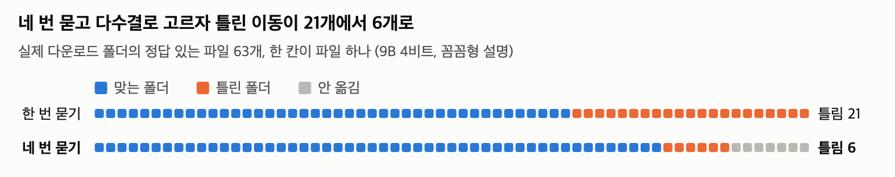
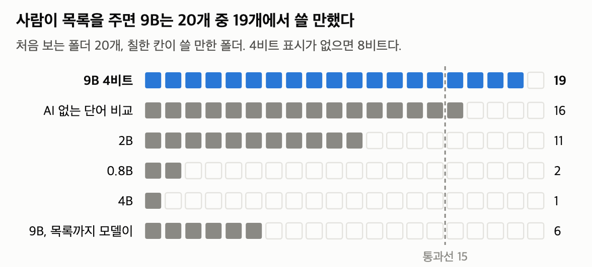
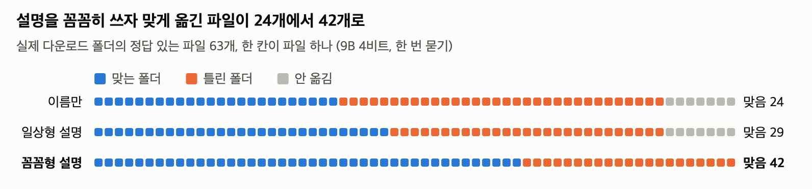
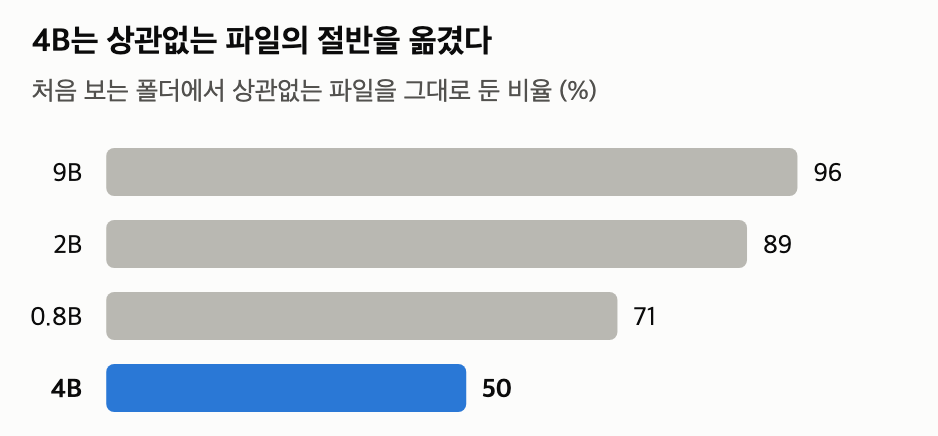

[English](README.md) · [한국어](README.ko.md) · [中文](README.zh-cn.md)

# file-sorting-qwen3.5

**작은 Qwen은 폴더를 나눌 수 있다. 무엇으로 나눌지는 못 정한다.**

내 컴퓨터에서 도는 Qwen3.5 9B가 폴더의 파일을 프로젝트별로 나눠 주는 도구다. 사람이 프로젝트 이름과 설명 한 줄을 주면, 처음 보는 합성 폴더 20개 중 19개에서 계획을 조금만 고쳐 승인할 수 있었다(RTX 4090에서 잼, 설명은 정답을 보고 쓴 최선 조건). 목록까지 모델에게 맡기면 9B(8비트)도 6개였다(같은 8비트에 목록을 주면 18개).

모델이 파일마다 갈 폴더를 고르면 사람이 그 계획을 승인해야 옮긴다. 파일은 지우지 않는다. 옮긴 것은 되돌릴 수 있다.


16GB 맥에서 9B 4비트로 시험 폴더를 정리하고 되돌렸다. 시험 폴더는 도구를 고칠 때 쓴 개발용 폴더다. 옮긴 14개는 모두 정답과 같았다. 모델이 고르는 3분 13초는 30배속, 나머지는 3배속이다.

## 목차

- [모델](#모델)
- [빠른 시작](#빠른-시작)
- [요약](#요약)
- [가져다 쓸 수 있는 방법 셋](#가져다-쓸-수-있는-방법-셋)
- [1 시험 방법](#1-시험-방법)
- [2 내 기기에서 돌아가나](#2-내-기기에서-돌아가나)
- [3 기능별 결과](#3-기능별-결과)
- [4 권장](#4-권장)
- [5 한계와 재지 않은 것](#5-한계와-재지-않은-것)
- [6 더 작은 모델](#6-더-작은-모델)
- [자주 묻는 질문](#자주-묻는-질문)
- [레포 구성](#레포-구성)
- [라이선스](#라이선스)

## 모델

- **모델:** [Qwen3.5](https://huggingface.co/collections/Qwen/qwen35) 9B를 4비트로 줄인 GGUF 파일이다([unsloth/Qwen3.5-9B-GGUF](https://huggingface.co/unsloth/Qwen3.5-9B-GGUF)의 `Qwen3.5-9B-Q4_K_M.gguf`, 5.7GB). 생각 모드는 쓰지 않는다.
- **실행:** [model-compose](https://github.com/hanyeol/model-compose)가 llama.cpp로 띄운다. 모델과 웹 화면을 설정 파일 하나로 묶어 띄우는 도구다.
- **본문은 9B 결과다.** 0.8B·2B·4B와 2비트도 같은 방식으로 쟀고 [6절](#6-더-작은-모델)에 모았다.

## 빠른 시작

준비물
- macOS나 Linux, Python 3.12(`python3.12 --version`으로 확인, 없으면 `brew install python@3.12`)
- 빈 메모리 6.9GB 이상. 쓰지 않는 큰 앱은 닫는다. 스왑이 차면 몇 배 느려진다(2절).
- macOS는 Xcode Command Line Tools(`xcode-select --install`). 설치 중에 llama-cpp-python을 빌드한다.
- NVIDIA GPU가 있는 Linux는 CUDA 툴킷(`nvcc`)이 필요하고 `CMAKE_ARGS="-DGGML_CUDA=on" pip install -r requirements.txt`로 설치한다. 그냥 `pip install`을 하면 llama-cpp-python이 CPU 전용으로 빌드되어 훨씬 느리다.
- 처음 띄울 때 모델 파일 5.7GB를 받는다.

**1. 설치**

```bash
git clone https://github.com/MindrLabs/file-sorting-qwen3.5.git
cd file-sorting-qwen3.5
python3.12 -m venv .venv && source .venv/bin/activate
pip install -r requirements.txt   # model-compose 0.4.120, llama-cpp-python 0.3.36, torch 2.14.1, huggingface_hub 2.2.0으로 고정했다
cp .env.sample .env                # 측정한 설정: 9B 4비트, 문맥 8K. 이 줄을 빼면 4B 8비트로 뜬다
```

**2. 시험 폴더로 써 보기**

```bash
cp -R examples/sample-folder workspace    # 시험 폴더(맨 위 파일 19개)
model-compose up
```

터미널에 `Uvicorn running on http://127.0.0.1:8081`이 뜨면 http://localhost:8081 을 연다. 위쪽 탭은 `organize`, `draft-projects`, `organize-quick`, `undo` 넷이고 첫 탭 `organize`가 열린다. 화면 문구는 영어다.

1. `projects` 칸에 아래 세 줄을 붙여 넣고 **Run Workflow**를 누른다. 칸을 비우면 모델이 목록까지 만드는데 그때 결과가 훨씬 나빴다(3.1). 화면의 안내문 "Leave empty to let the model name them"은 이 경우를 말한다.

   ```text
   gpu-bench: GPU benchmark runs: results, run and plot scripts.
   tax-2026: 2026 taxes: receipts, invoices, and withholding statements.
   wedding: Wedding planning: guest list, venue quotes, and invitations.
   ```

2. 16GB 맥에서 2\~3분 기다리면 "Awaiting 1 answer" 아래에 계획이 뜬다. `plan`에 `파일 => 폴더`가 줄바꿈 없이 이어져 있다.
3. **Answer 칸을 비운 채 Resume**을 누르면 승인이다. 파일이 옮겨지고 결과 칸에 한 줄씩 나온다. 계획에 없는 파일은 그대로 남는다. Finder나 `ls -R workspace`로 확인할 수 있다.

   

4. 되돌리려면 `undo` 탭에서 **Run Workflow**를 누른다. 누를 때마다 정리를 하나씩 되돌린다.

시험 폴더를 처음 상태로 다시 깔려면 `rm -rf workspace && cp -R examples/sample-folder workspace`를 실행한다.

> 첫 탭은 파일마다 목록 순서를 바꿔 네 번 묻고 셋 이상 같을 때만 옮긴다([방법 2](#2-순서를-바꿔-여러-번-묻고-다수일-때만-옮긴다)). 파일 40개 안팎의 폴더 하나에 16GB 맥에서 중앙값 7분 38초, RTX 4090에서 약 20초 걸렸다. 계속 Running이면 Cancel을 누르고 다른 앱을 닫은 뒤 다시 돌린다.

**3. 내 폴더에 쓰기**

1. 서버를 끄고(Ctrl+C) `.env`의 `ORGANIZE_ROOT`를 정리할 폴더의 절대 경로로 바꾼 뒤 다시 띄운다. 모델은 이 폴더 밖을 읽거나 옮기지 못한다.

   ```bash
   ORGANIZE_ROOT=/Users/me/Downloads/sort-me    # 처음에는 파일 수십 개짜리 폴더로
   ```

2. `projects` 칸에 내 프로젝트를 한 줄에 하나씩 `이름: 설명`으로 적는다. 좋은 줄을 쓰는 법은 [방법 1](#1-기준은-사람이-설명-한-줄과-함께)에 있다. 막막하면 `draft-projects` 탭의 초안을 고쳐 쓴다. 초안은 대부분 고쳐야 한다([자주 묻는 질문](#목록을-사람이-쓰면-무슨-의미가-있나)). 초안 탭은 파일을 옮기지 않는다.
3. 계획에 틀린 줄이 많으면 **Cancel**을 누른다. 아무것도 옮기지 않는다. 설명을 고쳐 다시 Run하는 편이 JSON으로 고치는 것보다 쉽다.

정리하는 범위
- 맨 위에 있는 파일만 옮긴다. 하위 폴더 안의 파일, 숨김 파일, 바로가기(심볼릭 링크)는 건드리지 않는다.
- 맨 위 하위 폴더가 6개 이하면 모두 옮길 곳 후보가 된다. 그보다 많으면 `projects` 칸에 이름을 적은 폴더만 후보다.
- PDF나 이미지처럼 글이 아닌 파일은 이름만 보고 고른다.
- 파일마다 따로 묻기 때문에 시간은 파일 수에 비례한다. 맥에서 9B 한 번 묻기로 파일 100개면 5분쯤으로 어림된다. 수백 개짜리 폴더로는 재지 않았다.

<details>
<summary>계획 고치기·거절, 빠른 탭, 투표 기록, 2B로 바꾸기, 포트</summary>

- **계획을 고쳐서 승인:** Answer 칸에 승인 단계의 `id`를 키로 JSON을 적는다. 예: `{"<id>": "a.txt => tax-2026\nb.txt => wedding"}`. 줄바꿈은 `\n`으로 쓴다.
- **거절:** `{"<id>": "REJECT: 이유"}`
- **Answer 칸에 다른 글을 넣어 화면이 진행되지 않으면** Cancel을 누르고 다시 Run한다.
- **더 빠르게:** `organize-quick` 탭은 한 번만 묻는다. 맥에서 약 2분이다. 다만 실제 다운로드 폴더에서는 쓸 만하지 않았다(3.4).
- **왜 제자리에 남았나:** 파일마다 네 번의 답이 그 폴더의 `.organizer/votes/`에 한 줄씩 남는다. 답이 갈렸는지(프로젝트 이름이나 `none`), 목록에 없는 답이었는지(`null`, 모델이 실제로 쓴 답이 옆에 남는다) 볼 수 있다.
- **이미 있는 폴더:** 설명을 붙여도 쓰이지 않는다. 이름만으로 내용을 알기 어려운 폴더는 먼저 이름을 바꿔 두는 편이 낫다(재지 않았다).
- **2B로 바꾸기:** `.env`의 세 줄(`LLM_REPO`, `LLM_GGUF`, `LLM_REVISION`)을 `.env.sample` 주석에 적힌 2B 값으로 바꾼다. `LLM_REVISION`은 측정에 쓴 모델 파일의 커밋이다. 파일 1.3GB, 메모리 2GB, 맥에서 폴더 하나에 30초 남짓(한 번 묻기)이다. 다만 처음 보는 폴더 중 쓸 만했던 비율은 절반이 안 되고 맥에서 잰 개발용 4폴더 중에서는 1폴더만 쓸 만했다([6절](#6-더-작은-모델)).
- **다시 돌린 결과를 공유할 때:** `python3 tools/env_report.py [모델.gguf]`가 버전과 모델 파일을 적어 준다.
- **포트:** 웹 화면은 8081, API는 8080이다. 둘 다 model-compose 0.4.120의 기본값대로 이 컴퓨터(127.0.0.1)에서만 열린다. `.env`의 `SERVER_PORT`, `PORT`로 바꾼다.

</details>

## 요약

여기부터는 측정 결과다. 쓰기만 할 거라면 [가져다 쓸 수 있는 방법 셋](#가져다-쓸-수-있는-방법-셋)과 [4 권장](#4-권장), [자주 묻는 질문](#자주-묻는-질문)만 읽어도 된다.

- "쓸 만한 폴더"는 모델의 첫 계획을 다섯 줄에 한 줄 이하만 고치고 승인할 수 있었던 폴더다. 승인 여부는 정답표를 가진 채점 프로그램(대리 검토자)이 판단했다([1절](#1-시험-방법)).
- "처음 보는 폴더"(held-out)는 측정 도구를 다 고친 뒤에만 쓴, 측정하는 쪽이 내용을 보지 않은 합성 폴더 20개다.
- "짝 F1"(0\~1)은 같은 프로젝트 파일끼리 같은 폴더로 묶였는지 보는 점수다. 1이면 정답과 같은 묶음이다.
- 이름 뒤에 양자화 표시가 없는 모델은 8비트(Q8_0)다. 4비트는 Q4_K_M 파일이다. 실제 폴더에서 잰 9B는 모두 4비트다. [ ]는 Wilson 95% 구간이다.

1. **프로젝트 목록과 설명을 주면 9B 4비트는 처음 보는 폴더 19/20([76, 99])에서 쓸 만했다.** 모델이 목록까지 만들면 9B도 6/20이었다. [3.1](#31-목록을-주면-vs-목록까지-맡기면)
2. **설명 한 줄이 결과를 바꿨다.** 실제 다운로드 폴더에서 9B의 짝 F1은 프로젝트 이름만 주면 0.32, 파일 이름까지 보고 쓴 설명(꼼꼼형)을 주면 0.46이었다. [방법 1](#1-기준은-사람이-설명-한-줄과-함께)
3. **목록 순서를 바꿔 네 번 묻고 다수일 때만 옮기면 틀린 이동이 줄었다.** 실제 다운로드 폴더에서 틀린 폴더로 간 파일이 21개에서 6개로 줄었다(한 폴더, 한 번). 시간은 2.4\~2.5배 든다. [3.2](#32-네-번-묻고-다수결)
4. **9B 4비트는 16GB 맥에서 최대 6.9GB로 돌았다.** 폴더 하나에 한 번 묻기는 약 2분, 네 번 묻기는 중앙값 7분 38초였다(스왑이 없을 때). [2절](#2-내-기기에서-돌아가나)
5. **9B는 4비트로 줄여도 8비트와 결과가 같았다.** [3.5](#35-양자화)
6. **정리할 것이 없는 폴더는 맡길 수 없었다.** 모두 그대로 둬야 하는 데스크톱 복제본(파일 30개)에 목록까지 맡기자 9B 4비트도 25개를 옮기려 했다. [3.3](#33-고르기와-그대로-두기)
7. **AI 없는 비교 기준도 합성 폴더에서는 통과했다(TF-IDF 16/20).** 9B 4비트와의 차이는 말할 수 없었다. 실제 다운로드 폴더에서는 통과하지 못했다. [자주 묻는 질문](#tf-idf-같은-단어-비교면-되지-않나)
8. **측정하는 동안 파일을 잃은 적이 없다.** 측정 실행 4,983번 모두 정리 직후 되돌리면 모든 파일이 처음과 같았다. [방법 3](#3-미리-보기와-되돌리기)

**이 숫자를 읽을 때**

- 19개는 최선 조건의 숫자다. 프로젝트 설명은 정답을 보고 썼고, 승인은 정답표를 가진 채점 프로그램이 판단했다. 사람이 검토하면 이보다 낮을 수 있다([1.1](#11-대리-검토자는-믿을-만한가)). 권장 설정(9B 4비트, 네 번 묻기)은 다른 설정의 결과를 본 뒤에 더한 칸이다(5절).
- 실제 폴더는 둘이고 설정마다 한 번씩 쟀다. 실제 다운로드 폴더에서는 꼼꼼형 설명에 네 번 묻기를 더했을 때만 쓸 만했다([3.4](#34-실제-다운로드-폴더)).
- 프로젝트를 이미 알고 파일이 수십 개인 폴더에 맞는다. 무엇으로 나눌지 아직 모르거나 정리할 것이 거의 없는 폴더에는 맞지 않는다([자주 묻는 질문](#목록을-사람이-쓰면-무슨-의미가-있나)).

표 1: 권장 설정 (이름과 설명을 줌. 실제 다운로드 칸은 꼼꼼형 설명)

| 설정 | 모델 파일 | 메모리 (16GB 맥) | 맥, 폴더 하나 | RTX 4090, 폴더 하나 | 처음 보는 폴더 중 쓸 만한 폴더 | 실제 다운로드 (한 번 잼) |
|---|---|---|---|---|---|---|
| **9B Q4_K_M, 네 번 묻기 (첫 탭)** | 5.7GB | 6.9GB | 7분 38초 | 약 20초 | **19/20 = 95% [76, 99]** | 쓸 만함 (고칠 줄 9.4%) |
| 9B Q4_K_M, 한 번 묻기 | 5.7GB | 6.5GB | 약 2분 | 약 8초 | 19/20 = 95% [76, 99] | 쓸 만하지 않음 (고칠 줄 32.8%) |

- 폴더 하나는 파일 40개 안팎이다. 시간은 요청 하나에 답을 받기까지의 중앙값이고 모델을 처음 올리는 시간은 뺐다. 메모리는 폴더 중 가장 큰 값이다.
- 맥 두 줄 모두 측정하는 동안 스왑이 늘지 않았다(네 번 묻기는 측정 전후 0). 스왑이 차면 훨씬 느려진다(2절).
- 처음 보는 폴더는 문맥 65K로 쟀고 시간과 메모리는 8K로 쟀다. 두 문맥의 첫 계획은 개발용 폴더의 한 번 묻기에서만 비교했고 같았다.
- 메모리는 1GB를 1024MB로 셌다. 2B 4비트는 [6절](#6-더-작은-모델)에 있다.

## 가져다 쓸 수 있는 방법 셋

이 도구가 쓰는 방법 셋이다. 첫째는 측정으로 효과를 확인했다. 둘째는 틀린 이동과 함께 옮기는 파일도 줄였고 9B에서 쓸 만한 폴더가 늘어난 것은 실제 폴더 한 번뿐이다. 셋째는 안전장치다. 다른 분류 일에도 같은 구조를 써 볼 수 있지만 이 레포에서는 파일로만 쟀다.


그림 1: 폴더 정리가 일하는 순서. 상자 위의 이름은 그 단계를 맡는 쪽이다.

### 1. 기준은 사람이, 설명 한 줄과 함께

9B는 처음 보는 합성 폴더에서 "이 파일이 이 프로젝트 것인가"를 잘 골랐다(정해 준 폴더로 맞게 보낸 비율 95%). 그러나 "이 폴더에 어떤 프로젝트들이 있나"는 찾지 못했다(3.1). 그래서 프로젝트 목록은 사람이 준다. 이름만 주지 말고 한 줄 설명을 붙인다.

| 덜 좋은 줄 | 좋은 줄 |
|---|---|
| `garden` | `garden: 씨앗 주문, 화단 배치도, 토마토 모종` |
| `tax` | `tax-2026: 2026 taxes: receipts, invoices, and withholding statements.` |
| `misc: 기타 파일` | 쓰지 않는다. 어디에도 안 맞는 파일은 목록에 없어도 그대로 남는다 |

- 설명에는 그 일에 속한 파일에 실제로 나오는 단어를 쓴다. 사람, 장소, 문서 종류 같은 것이다.
- 이미 있는 폴더는 그 이름을 그대로 쓴다. 새 이름을 쓰면 같은 일이 두 폴더로 갈라진다. 이미 있는 폴더에 붙인 설명은 쓰이지 않는다.
- 실제 다운로드 폴더에서 9B는 파일 이름까지 보고 쓴 설명("꼼꼼형")을 받았을 때, 프로젝트 이름만 보고 3\~6단어로 쓴 설명("일상형")을 받았을 때보다 13개 파일을 더 맞혔다(63개 중 42개 대 29개). 일상형은 이름만 준 것과 거의 같았다(짝 F1 0.31 대 0.32).

### 2. 순서를 바꿔 여러 번 묻고 다수일 때만 옮긴다

파일마다 같은 질문을 목록 순서만 바꿔 네 번 묻는다. 네 번 중 세 번 이상 같은 프로젝트를 고르면 옮기고 아니면 그대로 둔다. 후보가 넷보다 적으면 후보 수만큼 묻고 모두 같을 때만 옮긴다. "셋 이상"이라는 문턱은 데이터에 맞춰 고른 숫자가 아니다. 규칙의 나머지는 개발용 폴더에서 만들었다(5절).

여러 번 묻고 다수를 따르는 방법([self-consistency](https://arxiv.org/abs/2203.11171))과 목록 순서를 바꿔 여러 번 묻는 방법([permutation self-consistency](https://arxiv.org/abs/2310.07712))은 이미 알려져 있다. 이 도구는 두 방법을 함께 쓰고 다수가 나오지 않으면 옮기지 않는다.



그림 2: 네 번 묻기는 확신이 없는 7개를 옮기지 않았다. 한 폴더, 한 번의 결과다. 처음 보는 폴더 20개에서는 고칠 줄이 8.3%에서 4.3%로 줄었고 쓸 만한 비율은 그대로였다(표 4).

- 묻는 횟수가 네 배라 시간이 2.4\~2.5배 든다(4090 합계 기준).
- 확신 없는 파일은 옮기지 않으니 옮기는 파일도 준다. 실제 다운로드에서 9B는 정답이 있는 파일 63개 중 7개를 그대로 뒀다. 그래서 고칠 줄 비율만 보면 효과가 실제보다 커 보인다(3.4).
- 더 작은 모델에서는 효과가 달랐다([6절](#6-더-작은-모델)).

### 3. 미리 보기와 되돌리기

- 모델은 파일을 직접 옮기지 못한다. 모델이 고른 답을 코드가 계획으로 모으고 사람이 승인한 계획대로 코드가 옮긴다.
- 파일은 지우지도, 덮어쓰지도 않는다. 옮길 자리에 같은 이름의 파일이 있으면 그 줄은 건너뛴다. 옮길 때마다 기록을 남겨, `undo`로 최근 정리부터 차례로 되돌린다. 측정 실행 4,983번 모두 되돌리기 뒤 모든 파일이 처음과 같았다. 같은 폴더를 되풀이한 실행이라 서로 독립인 시행은 아니다. 권한 문제, 클라우드 동기화 폴더, 정리한 뒤 파일을 고치고 나서 되돌리는 경우는 시험하지 않았다.
- 승인 화면만으로는 틀린 줄을 다 거르지 못한다. 작성자가 계획을 직접 검토했을 때 틀린 줄의 약 6분의 1은 사람 눈에도 맞아 보였다(표본이 작다, [1.1](#11-대리-검토자는-믿을-만한가)).

## 1 시험 방법

다시 확인하는 법
- 모든 표는 `python3 scripts/report_tables.py`로 구간과 함께 다시 낼 수 있다.
- 어떤 결과 파일이 어느 표를 뒷받침하는지: [results/README.md](results/README.md)
- 폴더를 다시 만들어 재는 방법, 첫 계획 해시로 바이트까지 같은지 확인하는 방법: [measure/README.md](measure/README.md)
- 등록한 예상과 바꾼 기록: [docs/preregistration.ko.md](docs/preregistration.ko.md)

이 리포트에서 쓰는 말은 다음과 같다.

- **쓸 만한 폴더(쓸 만한 실행):** 첫 계획을 조금만 고치고 승인할 수 있는 경우다. 넷을 모두 만족해야 한다. 고칠 줄이 20% 이하, 정답이 있는 파일의 60% 이상을 옮김, 이미 정리된 폴더는 건드리지 않음, 끝나면 멈춤. 승인 여부는 대리 검토자가 판단한다. 정답 있는 파일의 60% 이상만 옮기면 되므로, 쓸 만한 폴더에도 옮기지 않은 파일이 남을 수 있다.
- **통과:** 처음 보는 폴더 20개에서 쓸 만한 폴더가 15개(75%) 이상이다. 쓸 만한 비율의 95% 신뢰구간 하한이 0.5 이상이 되는 선이라, 넘으면 쓸 만한 비율이 절반을 넘는다고 말할 수 있다. 9B 4비트는 20개 중 19개라 이 하한이 76%다. 쓸 만한 비율은 문턱으로 자른 값이라, 짝 F1의 작은 차이에도 크게 움직일 수 있다.
- **고칠 줄 비율:** 대리 검토자가 첫 계획에서 고치거나 지운 줄 ÷ 계획의 줄 수다. 두 프로젝트 어디에 둬도 되는 애매한 파일은 채점에서 뺀다(분자와 분모 모두). 소수 첫째 자리까지 적는다. 그리고 프로젝트마다 가장 많이 간 폴더를 그 프로젝트의 폴더로 본다. 그래서 한 프로젝트를 통째로 다른 이름의 폴더에 모아도 맞는 줄로 센다.
- **짝 F1(pairwise F1, 0\~1):** 같은 프로젝트 파일 두 개가 같은 폴더로 갔는지를 짝으로 세어 낸 점수다. 1이면 정답과 같은 묶음이다. 파일이 하나뿐인 프로젝트는 짝이 없어 거의 잡히지 않는다. 모델끼리 비교할 때는 같은 폴더끼리 차이를 내고 폴더를 다시 뽑아 95% 구간을 냈다. 구간이 0을 포함하지 않으면 "차이가 있다", 0을 포함하고 구간 전체가 ±0.05 안이면 "같다", 그 밖은 "판단할 수 없다"고 쓴다.
- **대리 검토자:** 정답표를 가진 프로그램(오라클)이다. 사람 대신 첫 계획의 틀린 줄을 고치고 승인한다. 애매한 파일은 고치지 않는다.

처음 보는 폴더와 개발용 폴더의 정확도는 RTX 4090에서, 실제 폴더는 16GB 맥에서 쟀다. 폴더, 설명, 엔진, 비교 기준, 흐름의 자세한 조건은 아래에 접어 두었다.

<details>
<summary>시험 조건 전체</summary>

| 항목 | 내용 |
|---|---|
| 처음 보는 폴더 | 판정용 합성 폴더 20개. 측정하는 쪽은 폴더 내용을 보지 않았다. 흐름을 동결한 뒤 설정마다 한 번씩 썼고 9B 4비트 칸과 네 번 묻기 칸은 다른 칸의 결과를 본 뒤에 더했다(5절). 폴더 하나는 파일 39\~48개, 프로젝트 4\~6개다 |
| 개발용 폴더 | 도구를 고칠 때 쓴 합성 폴더 12개. 처음 보는 폴더와 같은 방식으로 만들었다. 파일의 37%는 어느 프로젝트에도 속하지 않아 그대로 둬야 한다. 빠른 시작의 시험 폴더(`examples/sample-folder`)는 이보다 먼저 쓴 개발용 폴더 하나다 |
| 합성 폴더 만드는 법 | 프로젝트, 파일 이름, 단서 문장의 위치는 측정하는 쪽과 분리해 설계했고 파일은 고정 시드 생성기가 만들었다. 글 파일은 프로젝트와 상관없는 문단으로 채우고 단서 문장을 앞 300자 안, 300\~2,000자 사이, 2KB 뒤 중 한 곳에 넣었다. 글이 아닌 파일은 실제 형식의 머리와 무작위 바이트라 내용을 읽을 수 없다 |
| 프로젝트 설명 | 폴더마다 정답과 파일 이름·앞부분을 보고 썼다. "하는 일: 들어갈 것 3\~4가지" 꼴로 90자 이하이고 파일 이름을 그대로 쓰지 못하게 했다. 이미 있는 폴더는 설명하지 않았다. 자기 프로젝트를 잘 아는 사람이 한 번 적어 준 경우에 해당하는 최선 조건이다 |
| 실제 폴더 | 작성자의 다운로드 폴더에서 최근 파일 70개를 복제한 폴더(프로젝트 19개, 정답은 작성자가 확정)와 데스크톱 복제본(파일 30개, 모두 그대로 둘 파일). 다운로드 설명 두 벌(꼼꼼형·일상형)도 정답표를 보고 썼다 |
| 기기 | 처음 보는 폴더와 개발용 폴더의 정확도는 RTX 4090(24GB)에서, 실제 폴더는 16GB 맥(Apple M2)에서 쟀다. 메모리와 시간은 둘 다에서 쟀다. 9B 4비트 개발용 폴더는 DGX Spark(GB10)에서 한 번 더 돌렸다 |
| 엔진·설정 | llama.cpp(llama-cpp-python), model-compose. 생각 모드는 쓰지 않았다. 문맥은 처음 보는 폴더가 65K, 맥에서 잰 권장 설정이 8K다. 측정은 presence_penalty·min_p를 llama.cpp에 넘기는 model-compose 빌드(0.4.120 기반)로 했다. PyPI 0.4.120은 이 두 값을 넘기지 않는다. 맥에서 잰 개발용 4폴더(2B·9B 4비트, 한 번 묻기)의 첫 계획 8개는 두 빌드에서 같았다(이 비교는 작업 기록에만 있고 results/에는 없다) |
| 반복 | 폴더마다 한 번. 같은 기기에서 같은 설정으로 다시 돌리면 첫 계획이 바이트까지 같았다. 맥과 4090은 같은 모델 파일과 설정값에서도 첫 계획이 다를 수 있었다. 빌드도 달랐다(5절) |
| 모델이 보는 것 | 파일마다 파일 이름과, 글 파일이면 앞부분 300자. 그리고 프로젝트 목록. 목록을 사람이 줘도 프로젝트 단계에서 파일마다 160자로 자른 목록을 한 번 본다 |
| 비교 기준 | AI 없는 TF-IDF 단어 비교와 0.6B 임베딩(Qwen3-Embedding-0.6B). 모델과 같은 목록을 받고 파일은 이름과 글 파일 앞부분 2KB를 읽는다(모델보다 많이 본다). 가장 비슷한 프로젝트로 보내고 비슷한 정도가 문턱 아래면 그대로 둔다. 문턱은 개발용 폴더에서 짝 F1이 가장 높은 값으로 정했고 실제 폴더에도 그 값을 그대로 썼다 |
| 흐름 | **단계형**(이 도구): 코드가 순서를 정하고 모델은 파일마다 고르기만 한다. **도구 에이전트**: 모델이 도구(폴더 보기, 미리 보기, 읽기, 묶음 제안, 목록 정하기, 배정, 제출)를 골라 가며 스스로 진행한다. 3.6과 6절에서 비교한다 |

</details>

### 1.1 대리 검토자는 믿을 만한가

작성자가 계획 일부를 대리 검토자의 판단을 보지 않고 직접 고쳐 비교했다. 표본이 작다(5절).

- 대리 검토자가 고친 줄의 83%를 사람도 고쳤다. 나머지 약 6분의 1은 틀린 줄인데도 사람 눈에 맞아 보여 고치지 않았다.
- 사람은 그 대신 이름만으로 확신이 서지 않는 줄을 더 많이 지웠다. 그래서 "고칠 줄 20%" 기준은 신중한 사람보다 후하다. 실제 사람이 검토하면 쓸 만한 폴더는 이 리포트의 숫자보다 줄 수 있다.

## 2 내 기기에서 돌아가나

이 도구는 모델에게 짧은 질문을 여러 번 하므로 긴 문맥이 필요 없다. 문맥을 65,536에서 8,192로 줄여 개발용 폴더를 한 번 묻기로 다시 돌렸더니, 9B 4비트의 첫 계획이 바이트까지 같았다(2B·4B도 같았다. 네 번 묻기는 비교하지 않았다). 메모리는 크게 줄었다.

표 2: 9B Q4_K_M의 메모리와 시간 (메모리는 폴더 중 최대, 시간은 중앙값, 1GB=1024MB)

| | RTX 4090 | 16GB 맥 | DGX Spark |
|---|---|---|---|
| 메모리, 문맥 65K | 9.5GB | 재지 않음 | 재지 않음 |
| 메모리, 문맥 8K | 6.0GB | 6.5GB (네 번 묻기 6.9GB) | 5.8GB |
| 폴더 하나, 한 번 묻기 | 8초 (8\~10초) | 2분 (1분 31초\~2분 49초) | 14초 (12\~14초) |
| 폴더 하나, 네 번 묻기 | 20초 (18\~24초) | 7분 38초 (5분 02초\~10분 46초) | 39초 (32\~44초) |

- 재지 않은 기기: M1·M3·M4 맥, 8GB 기기, Windows, 휴대폰. 메모리가 16GB인 다른 Apple Silicon 맥에서도 메모리는 들어갈 것으로 보지만 속도는 다를 수 있다.

<details>
<summary>스왑, DGX Spark, 27B 등 세부</summary>

- 맥 한 번 묻기는 측정 전후 스왑이 3.9GB로 같아 측정하는 동안 스왑이 늘지 않았다.
- 맥 네 번 묻기는 다른 앱을 닫고 쟀고 측정 전후 스왑이 0이었다. 스왑이 7.6GB에서 13.3GB로 늘어나는 상태로 쟀을 때는 끝난 3폴더의 중앙값이 10분 19초였고 한 폴더는 도구 명령이 시간 제한에 걸려 끝나지 않았다.
- 실제 다운로드 폴더(파일 70개)를 잴 때는 스왑이 8GB 안팎 차 있었고 9B가 한 번 묻기로 10분 30초, 네 번 묻기로 23분 36초 걸렸다.
- 맥과 4090은 같은 모델 파일과 설정값에서도 첫 계획이 달라질 수 있었다(5절). 맥에서 잰 개발용 4폴더에서 9B 4비트는 한 번 묻기로 4폴더 모두, 네 번 묻기로도 4폴더 모두 쓸 만했다.
- DGX Spark(NVIDIA GB10)에서는 PyPI의 model-compose 0.4.120과 CUDA로 빌드한 llama-cpp-python으로 개발용 12폴더를 모두 돌렸다. 네 번 묻기는 12폴더 모두 쓸 만했고 한 번 묻기는 12폴더 중 11폴더가 쓸 만했다(dev-07은 고칠 줄이 21.4%로 기준 20%를 넘었다. 4090에서는 18.5%였다). 첫 계획이 4090과 같은 폴더는 네 번 묻기 12폴더 중 7폴더, 한 번 묻기 12폴더 중 6폴더였다. 이 재측정에 쓴 도구는 멈춤 검사를 보지 못해서 여기의 "쓸 만함"에는 그 검사 하나가 빠졌다. PyPI 0.4.120은 `presence_penalty`와 `min_p`를 넘기지 않는다(`.env.sample`). 메모리는 `nvidia-smi`로 잰 서버의 GPU 메모리다. 측정하는 동안 다른 사용자의 서비스가 공유 메모리 약 56GB를 잡고 있었고 측정 직전과 직후의 GPU 사용률은 0%였다. 시험 폴더(최상위 파일 19개)에서는 한 번 묻기 10초, 네 번 묻기 20초 걸렸다.
- 27B 4비트(16.7GB)는 도구 에이전트 흐름과 문맥 65K로 24GB GPU에서 돌리자 첫 실행 도중 CUDA 오류로 멈췄다. 메모리 부족인지는 따로 확인하지 않았고 등록대로 문맥을 줄여 다시 재지 않았다.
- 더 작은 모델의 메모리와 시간은 [6절](#6-더-작은-모델)에 있다.

</details>

## 3 기능별 결과

### 3.1 목록을 주면 vs 목록까지 맡기면

목록과 설명을 주면 9B는 4비트와 8비트 모두 통과했고(19개, 18개) AI 없는 TF-IDF도 통과했다(16개). 모델이 목록까지 만들면 9B도 6개였다.



그림 3: 표 3과 표 8에서 골랐다. 통과선은 20개 중 15개다.

<details>
<summary>표 3과 통계</summary>

표 3: 처음 보는 폴더 20개 중 쓸 만한 폴더 (단계형, 문맥 65K)

| 설정 | 쓸 만한 폴더 |
|---|---|
| 9B 4비트, 이름과 설명 | **19/20 = 95% [76, 99] (통과)** |
| 9B 4비트, 이름과 설명, 네 번 묻기 | **19/20 = 95% [76, 99] (통과)** |
| 9B 8비트, 이름과 설명 | **18/20 = 90% [70, 97] (통과)** |
| TF-IDF (AI 없음), 이름과 설명 | **16/20 = 80% [58, 92] (통과)** |
| 9B 8비트, 모델이 목록을 만듦 | 6/20 = 30% [15, 52] |

- 통과선은 구간 하한 50%다(20개 중 15개 이상). 9B 8비트와 4비트는 한 폴더 차이라 우열을 말할 수 없다.
- 목록을 주면 9B 8비트는 6개에서 18개로 늘었다(McNemar, Holm p 0.004). 짝 F1도 +0.135 [+0.077, +0.203]로 차이가 있다.
- 9B 4비트와 TF-IDF의 차이는 말할 수 없었다(19 대 16, Holm p 1.0). 짝 F1 차이도 −0.007 [−0.090, +0.082]로 판단할 수 없다.
- 도구 에이전트가 만든 목록(개발용 폴더)에서 흔한 실수는 "기타"·"misc" 같은 잡동사니 폴더 만들기와 이미 있는 폴더를 다른 이름으로 또 만들어 한 프로젝트를 두 폴더로 가르기였다.
- 0.8B·2B·4B와 0.6B 임베딩을 포함한 전체 표는 [6절](#6-더-작은-모델)에 있다.

</details>

### 3.2 네 번 묻고 다수결

네 번 묻으면 실제 다운로드 폴더가 쓸 만해졌다(고칠 줄 32.8% → 9.4%). 처음 보는 폴더에서는 고칠 줄이 8.3%에서 4.3%로 줄었고 쓸 만한 폴더는 19개 그대로였다.

<details>
<summary>표 4와 통계</summary>

표 4: 한 번 묻기 → 네 번 묻기 (9B 4비트, 이름과 설명. 처음 보는 폴더는 문맥 65K, 나머지는 8K)

| 폴더 | 쓸 만한 폴더 | 고칠 줄 비율 | 그대로 둘 파일을 옮긴 수 | 짝 F1 |
|---|---|---|---|---|
| 처음 보는 폴더 | 19/20 → 19/20 | 8.3% → 4.3% | 15 → 6 | 0.63 → 0.64 |
| 개발용 폴더 | 12/12 → 12/12 | 6.3% → 4.1% | 11 → 7 | 0.67 → 0.69 |
| 실제 다운로드 | 아니오 → **예** | 32.8% → 9.4% | 4 → 3 | 0.46 → 0.84 |

- 처음 보는 폴더에서 두 방식의 차이는 말할 수 없다(Holm p 1.0). 짝 F1 차이는 +0.003 [−0.010, +0.017]로 같다.
- 폴더 종류마다 짝 F1의 크기는 서로 비교할 수 없다. 합성 폴더와 실제 폴더는 프로젝트 수와 크기가 다르다.
- 처음 보는 폴더에서 9B가 옮긴 짝 중 맞는 짝의 비율(짝 정밀도)은 0.81에서 0.89로 올랐고 정답 있는 파일 중 옮긴 비율은 0.78에서 0.74로 내려갔다.
- 2B·4B의 결과는 [6절](#6-더-작은-모델)에 있다.

</details>

### 3.3 고르기와 그대로 두기

처음 보는 폴더에서 9B는 정해 준 폴더를 95% 이상 맞게 골랐고 상관없는 파일도 95% 이상 그대로 뒀다.

정리할 것이 없는 폴더는 더 어렵다. 모두 그대로 둘 파일 30개가 든 실제 데스크톱 복제본에 목록까지 모델에게 맡기자 9B 4비트도 25개를 옮기려 했다. 사람이 목록을 준 조건으로는 재지 않았다. 더 작은 모델은 이 폴더에서 거의 모든 파일을 옮기려 했다([6절](#6-더-작은-모델)).

<details>
<summary>표 5</summary>

표 5: 처음 보는 폴더 20개 평균 (이름과 설명을 줌)

| 모델 | 정해 준 폴더로 맞게 보낸 비율 | 상관없는 파일을 그대로 둔 비율 |
|---|---|---|
| 9B | 95% [93, 97] | 96% [92, 98] |
| 9B 4비트 | 96% [93, 98] | 95% [92, 98] |

[ ]는 폴더를 다시 뽑아 낸 95% 구간이다. 9B는 정해 준 폴더를 잘 골랐고 상관없는 파일도 거의 그대로 뒀다.

</details>

### 3.4 실제 다운로드 폴더

프로젝트가 19개로 많고 그중 절반 넘게 파일이 1\~2개뿐이며 이름만으로 뜻을 알기 어려운 프로젝트가 많다. 프로젝트 4\~6개짜리 합성 폴더보다 훨씬 어렵다. 파일이 하나뿐인 프로젝트는 짝 F1에 거의 잡히지 않는다.

꼼꼼형 설명에 네 번 묻기를 더한 칸만 쓸 만했다(고칠 줄 9.4%). 비교 기준(TF-IDF, 임베딩)은 어느 칸도 쓸 만하지 않았다.



그림 4: 표 6과 같은 폴더, 한 번 묻기다. 꼼꼼형은 파일 이름까지 보고 쓴 설명, 일상형은 프로젝트 이름만 보고 짧게 쓴 설명이다.

<details>
<summary>표 6, 표 7과 세는 방법</summary>

표 6: 실제 다운로드 폴더의 첫 계획 (맥, 9B 4비트, 문맥 8K, 정답 있는 파일 63개)

| 설정 | 맞는 폴더 | 틀린 폴더 | 안 옮김 | 짝 F1 | 고칠 줄 비율 | 쓸 만한가 | 사람이 손댈 파일 |
|---|---|---|---|---|---|---|---|
| 꼼꼼형 설명, 네 번 묻기 | 50 | 6 | 7 | 0.84 | 9.4% | **예** | 16 |
| 꼼꼼형 설명 | 42 | 21 | 0 | 0.46 | 32.8% | 아니오 | 25 |
| 일상형 설명 | 29 | 27 | 7 | 0.31 | 38.9% | 아니오 | 37 |

- 꼼꼼형은 파일 이름까지 보고 문서 종류를 넣은 설명, 일상형은 프로젝트 이름만 보고 3\~6단어로 쓴 설명이다. 둘 다 정답표를 보고 썼다.
- 맞는·틀린 폴더와 안 옮김은 정답이 있는 파일 63개를 센 수다. 고칠 줄 비율은 대리 검토자 기준이라 세는 방식이 다르다. 애매한 파일(이 폴더에 6개)은 세지 않고 프로젝트마다 가장 많이 간 폴더를 그 프로젝트의 폴더로 본다. 한 프로젝트를 통째로 다른 이름의 폴더에 모은 줄은 맞게 세므로 틀린 폴더 수로 계산한 비율보다 낮다.
- 사람이 손댈 파일은 틀린 폴더, 잘못 옮긴 그대로 둘 파일, 안 옮긴 파일을 더한 수다.
- 한 번 묻기는 측정 빌드로, 네 번 묻기는 PyPI 0.4.120으로 쟀다. PyPI 판은 presence_penalty·min_p를 llama.cpp에 넘기지 않아서 두 판의 샘플링 설정이 조금 다르다(1절).

표 7: 같은 폴더, 모델과 같은 목록에서 9B 4비트와 비교 기준 (짝 F1, 괄호는 고칠 줄 비율)

| | 이름만 | 꼼꼼형 설명 | 일상형 설명 |
|---|---|---|---|
| 9B 4비트, 네 번 묻기 | 재지 않음 | **0.84 (9.4%)** | 재지 않음 |
| 9B 4비트, 한 번 묻기 | 0.32 (35.2%) | 0.46 (32.8%) | 0.31 (38.9%) |
| 0.6B 임베딩 | 0.49 (35.9%) | 0.40 (32.7%) | 0.36 (38.5%) |
| TF-IDF | 0.14 (24.0%) | 0.23 (22.6%) | 0.14 (26.9%) |

- 한 폴더 한 번의 결과라 구간이 없다. 아래의 "높았다"는 숫자를 나란히 놓은 것이지 차이를 판정한 것이 아니다.
- 비교 기준은 어느 칸도 쓸 만하지 않았다. TF-IDF는 고칠 줄이 가장 적었지만 정답 있는 파일을 37\~47%만 옮겨 기준(60%)에 못 미쳤다. 임베딩은 고칠 줄이 32.7\~38.5%였다.
- 이름만 주면 0.6B 임베딩(0.49)이 9B 한 번 묻기(0.32)보다 높았다. 대신 정답이 있는 파일을 모두 옮겼고 고칠 줄은 35.9%였다.
- 꼼꼼형 설명을 주면 9B는 0.32에서 0.46으로 올랐다. 비교 기준은 TF-IDF가 0.14에서 0.23으로 올랐고 임베딩은 0.49에서 0.40으로 내려갔다. 일상형 설명에서도 임베딩(0.36)이 9B 한 번 묻기(0.31)보다 높았다.
- 비교 기준에는 네 번 묻기처럼 확신이 없을 때 보류하는 장치가 문턱 하나뿐이고 그 문턱은 합성 개발용 폴더에서 정한 값이다.
- 2B의 실제 다운로드 결과는 [6절](#6-더-작은-모델)에 있다.

</details>

### 3.5 양자화

9B는 8비트에서 4비트로 줄여도 짝 F1 차이가 +0.003 [−0.011, +0.016]으로 같았다(처음 보는 폴더 20개, 같은 폴더끼리). 쓸 만한 폴더도 18개와 19개로 우열을 말할 수 없다. 2B·4B와 2비트는 [6절](#6-더-작은-모델)에 있다.

### 3.6 흐름: 코드가 순서를 정할 때 vs 모델이 도구를 고를 때

모델이 목록까지 만드는 조건에서 두 흐름을 견줬다. 9B는 코드가 순서를 정하는 단계형이 도구 에이전트보다 짝 F1이 +0.09 [+0.01, +0.18] 높았다. 다만 이 조건에서는 두 흐름 모두 통과에 한참 못 미쳤다(도구 에이전트 1/20 = 5%, 단계형 6/20 = 30%). 2B·4B는 [6절](#6-더-작은-모델)에 있다.

## 4 권장

- **프로젝트 이름과 한 줄 설명을 직접 적는다.** 설명에는 파일에 실제로 나오는 단어를 넣는다.
- **16GB 노트북이면 9B Q4_K_M, 문맥 8K, 첫 탭(네 번 묻기).** 다른 앱을 닫고 돌린다. 스왑이 없을 때 폴더 하나에 중앙값 7분 38초였다. 스왑이 찬 상태에서는 끝나지 않은 폴더가 있었다. 한 번 묻기는 빠르지만 실제 다운로드 폴더에서는 쓸 만하지 않았다. 네 번 묻기를 기본으로 둔 근거는 이 실제 폴더 한 번의 결과다. 처음 보는 폴더에서는 쓸 만한 비율이 그대로였다.
- **9B는 4비트로 충분했다.** 더 가벼운 모델(2B 등)은 [6절](#6-더-작은-모델)을 보고 고른다. 2B 4비트는 처음 보는 폴더의 45%만 쓸 만했다.
- **승인 화면만 믿지 말고 되돌리기를 쓴다.** 틀린 줄 일부는 사람 눈에도 맞아 보였다.
- **정리할 것이 거의 없는 폴더(데스크톱 등)는 맡기지 않는다.** 목록까지 모델에게 맡긴 조건에서 9B 4비트도 대부분 옮기려 했다.

## 5 한계와 재지 않은 것

- **판정용 폴더는 합성이다.** 프로젝트, 파일 이름, 단서 위치는 측정과 분리해 설계했지만 파일 내용은 개발용 폴더와 같은 생성기로 만들었다. 그래서 "처음 보는 설계"에는 답하지만 "처음 보는 종류의 폴더"에는 답하지 못한다. 합성 폴더에서는 AI 없는 TF-IDF도 통과했다.
- **프로젝트 설명은 정답을 보고 썼다.** 처음 보는 폴더에서는 최선 조건이다. 실제 다운로드에서도 폴더 주인이 정답표 없이 쓴 설명으로는 재지 않았다.
- **처음 보는 폴더를 여러 번 썼다.** 흐름을 동결한 뒤 설정마다 한 번씩 썼지만 9B 4비트 칸은 9B 8비트 결과(18개)를 본 뒤, 네 번 묻기 칸은 2B 4비트 결과(9개)를 본 뒤에 더했다. 네 번 묻기 규칙은 개발용 폴더로만 정했고 처음 보는 폴더에는 9B로 한 번 쟀다. 그래서 이 두 칸은 완전히 처음 보는 조건이 아니다.
- **실제 폴더는 둘이고 설정마다 한 번씩 돌렸다.** 네 번 묻기가 실제 다운로드에서 쓸 만해진 결과(틀린 이동 21 → 6)는 한 폴더, 한 번의 사례다. 통계적 주장이 아니다. 일상형 설명에 네 번 묻기를 더한 조건과, 데스크톱에 사람이 목록을 준 조건은 재지 않았다.
### 그 밖의 한계

- **반복과 목록 순서에 따른 흔들림은 담지 않았다.** 같은 기기에서 다시 돌리면 같은 첫 계획이 나와서 폴더마다 한 번씩 돌렸고 샘플링 시드나 목록 순서를 바꿔 다시 돌리지 않았다. 네 번 묻기의 효과가 보여 주듯, 한 번 묻기의 답은 목록 순서에 따라 달라질 수 있다.
- **맥과 4090의 결과가 다를 수 있다.** 같은 모델 파일과 설정값의 개발용 4폴더에서 9B 한 번 묻기의 첫 계획이 2폴더에서 달랐다(네 번 묻기는 1폴더). 두 기기는 llama.cpp와 model-compose 빌드가 달랐고 네 번 묻기는 설정 파일 판도 달랐다. 그래서 차이가 기기 때문인지 빌드 때문인지는 가를 수 없다. 그래서 4090에서 잰 비율이 맥에서 그대로 나온다고 말할 수 없다. 맥에서도 한 번 묻기는 4폴더 모두, 네 번 묻기도 4폴더 모두 쓸 만했다. 빌드가 또 다른 DGX Spark에서는 첫 계획이 4090과 같은 개발용 폴더가 네 번 묻기 12폴더 중 7폴더, 한 번 묻기 12폴더 중 6폴더였다.
- **표본 수.** 처음 보는 폴더는 20폴더 한 번씩이다(9B 4비트 19개, 9B 18개, TF-IDF 16개, 모델 목록 9B 6개). 네 번 묻기의 개발용 비교는 12폴더 한 번씩이다(9B 12 → 12개). 맥 시간은 개발용 4폴더씩이다. DGX Spark는 개발용 12폴더씩이다.
- **사람 확인은 작성자 한 사람, 계획 8개(166줄)다.** 대리 검토자가 고친 59줄 중 49줄을 사람도 고쳤고 틀린 59줄 중 10줄은 사람 눈에 맞아 보였다. 사람 기준으로 쓸 만한 폴더가 몇 개 줄어드는지는 세지 않았다.
- **목록 초안은 실제 다운로드에서 한 번 쟀다.** 9B 초안은 19개 프로젝트 중 4개 정도를 그대로 쓸 만했고 3줄은 서로 다른 일을 하나로 뭉쳤고 8개는 빠졌다. 초안은 2\~8개 프로젝트를 내도록 되어 있어, 프로젝트가 많은 폴더에서는 일부만 잡는다.
- **비교 기준의 보류 장치는 문턱 하나다.** 합성 개발용 폴더에서 정한 문턱을 실제 폴더에 그대로 썼다. 네 번 묻기에 맞먹는 보류 장치를 단 비교 기준과, 임베딩으로 묶고 모델이 이름만 붙이는 방식은 재지 않았다.
- **규모와 시간.** 파일이 수백 개 넘는 폴더와, 사람이 손으로 정리할 때 걸리는 시간과의 비교는 재지 않았다. 비교 기준(TF-IDF·임베딩)의 시간과 메모리도 재지 않았다.
- **글이 아닌 파일만 따로 센 결과는 없다.** PDF·이미지처럼 이름만 보고 고르는 파일의 정확도를 나눠 보지 않았다.
- **정답 묶음은 하나뿐이다.** 모델이 정답과 다르지만 그럴듯하게 나눈 경우도 틀린 것으로 센다. 사람이 정답표 없이 만든 목록을 같은 방식으로 채점한 상한은 재지 않았다.
- **Qwen3.5 한 계열만, 생각 모드를 끈 상태로만 쟀다.** 다른 계열과는 비교하지 않았다.
- **버전.** model-compose나 llama.cpp 버전이 바뀌면 같은 입력에도 출력이 달라질 수 있다. PyPI 0.4.120은 측정 빌드와 달리 presence_penalty·min_p를 넘기지 않는다(맥에서 잰 개발용 4폴더의 2B·9B 4비트 첫 계획 8개는 두 빌드에서 같았다. 이 비교는 작업 기록에만 있고 results/에는 없다). 파일 이름 언어(한국어·영어)에 따른 차이도 따로 보지 않았다.
- **학습(파인튜닝)은 범위 밖이다.** 받아서 바로 쓰는 모델이 어디까지 되는지를 물었다.

<details>
<summary>결과를 보기 전에 적은 예상과 결과</summary>

| 예상 | 결과 |
|---|---|
| 모델이 목록을 만들면 모두 불합격이고 9B가 가장 높다 | 반만 맞음: 모두 불합격이었지만 도구 에이전트에서는 4B 4비트(2개)가 9B(1개)보다 많았다 |
| 이름과 설명을 주면 2B는 불합격(20개 중 8\~14개) | 맞음(11개) |
| 이름과 설명을 주면 9B는 경계선 | 틀림: 18개로 통과 |
| 2B는 상관없는 파일을 잘 못 둔다 | 틀림: 89%를 그대로 뒀다 |
| 비교 기준(TF-IDF·0.6B 임베딩)은 통과 못 하고 짝 F1도 2B보다 낮다 | TF-IDF는 둘 다 틀림(16개로 통과, 짝 F1도 2B보다 높음). 임베딩은 둘 다 맞음(6개, 짝 F1도 2B보다 낮음) |
| 도구 에이전트에서 4B 4비트와 8비트는 판단할 수 없다 | 맞음(−0.013, 판단할 수 없음) |
| 도구 에이전트에서 4B 2비트는 8비트보다 떨어진다 | 맞음(−0.24) |
| 단계형에서 4B 2비트와 8비트는 판단할 수 없다 | 틀림: −0.05로 떨어졌다 |
| 네 번 묻기로 2B의 쓸 만한 폴더가 는다 | 틀림: 틀린 이동은 줄었지만 옮기는 파일도 줄어 그대로 |
| 네 번 묻기에서 9B는 지금 수준을 지킨다 | 맞음 |

9B 4비트 결과, 문맥 8K, 맥 메모리와 시간에 대한 예상은 결과와 함께 기록되어 결과 전 예상으로 볼 수 없어 뺐다. 등록 시각과 바꾼 기록은 [docs/preregistration.ko.md](docs/preregistration.ko.md)에 있다.

</details>

## 6 더 작은 모델

0.8B·2B·4B와 2비트도 9B와 같은 폴더, 같은 흐름으로 쟀다. 사전 등록한 비교라서 지우지 않고 이 절에 모았다. 전체 숫자는 [results/](results/README.md)와 `python3 scripts/report_tables.py`로 다시 낼 수 있다.

- **목록을 주는 효과는 모든 크기에서 있었다. 그래도 쓸 만한 계획을 꾸준히 낸 것은 9B뿐이다.** 목록까지 모델에게 맡기면 0.8B 0%, 2B·4B 5%였다. 개발용 폴더에서 따로 물어본 결과로는 4B부터 여러 파일에 공통된 프로젝트를 찾았다(0.8B·2B는 못 찾았다).
- **크기 순서가 아니다.** 목록을 주면 2B는 55%, 4B는 5%였다. 0.8B는 목록을 줘도 10%였다.
- **4B가 2B보다 낮은 원인 후보는 상관없는 파일까지 옮기는 것이다.** 4B는 상관없는 파일을 50%만 그대로 뒀다(2B 89%, 9B 96%). 데스크톱 복제본에서도 4B 4비트는 30개를 모두 옮기려 했다. 이 해석은 상관만 본 것이라 원인으로 단정하지 않는다. 다른 계열과 비교하지 않았으므로 4B 자체의 성질인지 이 흐름과 맞지 않는 것인지도 가를 수 없다.
- **양자화:** 9B·4B는 4비트에서 그대로였고 2B 4비트와 4B 2비트는 떨어졌다.

표 8: 처음 보는 폴더 20개 중 쓸 만한 폴더, 모든 크기 (단계형, 문맥 65K)

| 모델 | 목록을 모델이 만듦 | 이름만 줌 | 이름과 설명을 줌 |
|---|---|---|---|
| 0.8B | 0/20 = 0% [0, 16] | — | 2/20 = 10% [3, 30] |
| 2B | 1/20 = 5% [1, 24] | 3/20 = 15% [5, 36] | 11/20 = 55% [34, 74] |
| 4B | 1/20 = 5% [1, 24] | 0/20 = 0% [0, 16] | 1/20 = 5% [1, 24] |
| 9B | 6/20 = 30% [15, 52] | — | 18/20 = 90% [70, 97] (통과) |
| 2B 4비트 | 0/20 = 0% [0, 16] | — | 9/20 = 45% [26, 66] |
| 4B 4비트 | 1/20 = 5% [1, 24] | — | 1/20 = 5% [1, 24] |
| 4B 2비트 | 0/20 = 0% [0, 16] | — | 2/20 = 10% [3, 30] |
| 9B 4비트 | — | — | 19/20 = 95% [76, 99] (통과) |
| TF-IDF (AI 없음) | 해당 없음 | 10/20 = 50% [30, 70] | 16/20 = 80% [58, 92] (통과) |
| 0.6B 임베딩 | 해당 없음 | 9/20 = 45% [26, 66] | 6/20 = 30% [15, 52] |

- "—"는 재지 않은 칸이다. 목록을 주면 짝 F1은 모든 크기에서 올랐다(0.8B +0.13, 2B +0.16, 4B +0.10, 2B 4비트 +0.15, 4B 4비트 +0.11, 4B 2비트 +0.07, 모두 차이가 있다). 4B는 짝 묶기가 좋아져도 쓸 만한 폴더는 그대로였다.
- 2B는 이름만 줄 때 3개에서 설명을 더하면 11개로 늘었다(McNemar p 0.008). TF-IDF는 설명을 주면 올랐지만 0.6B 임베딩은 오히려 떨어졌다. 원인은 따로 보지 않았다.
- 짝 F1로는 TF-IDF가 2B(−0.13)·4B(−0.21)보다 높았다(둘 다 차이가 있다).



그림 5: 표 9의 8비트 줄이다.

<details>
<summary>표 9: 고르기와 그대로 두기, 모든 크기</summary>

표 9: 고르기와 그대로 두기, 모든 크기 (처음 보는 폴더 20개 평균, 이름과 설명을 줌)

| 모델 | 정해 준 폴더로 맞게 보낸 비율 | 상관없는 파일을 그대로 둔 비율 |
|---|---|---|
| 0.8B | 82% [77, 86] | 71% [62, 79] |
| 2B | 92% [88, 95] | 89% [83, 94] |
| 4B | 86% [82, 89] | **50% [44, 57]** |
| 9B | 95% [93, 97] | 96% [92, 98] |
| 2B 4비트 | 91% [87, 94] | 81% [74, 88] |
| 9B 4비트 | 96% [93, 98] | 95% [92, 98] |

4B는 고르기에서도 2B보다 조금 낮았지만 둘 다 미리 정한 기준(구간 하한 80%)을 넘었고 크게 갈린 것은 그대로 두기였다. 0.8B는 고르기도 기준에 못 미쳤다. 데스크톱 복제본(모두 그대로 둘 파일 30개)에서 첫 계획은 2B 29개, 4B 4비트 30개, 9B 4비트 25개를 옮기려 했다(2B·4B는 문맥 65K, 9B는 8K).

</details>

<details>
<summary>계단: 단마다 따로 매긴 통과</summary>

- 단마다 통과와 실패를 따로 매긴다. 앞 단에서 떨어져도 다음 단을 센다. 그래서 차례로 오르는 계단이 아니다.
- 단의 조건: 1 도구를 한 번이라도 불렀다. 2 계획을 냈고 읽을 수 없는 줄이 없다. 3 이름으로 알 수 있는 파일 중 옮긴 것이 모두 정답 폴더로 갔고 60% 이상 옮겼다. 4 같은 조건을 열어 봐야 아는 파일로. 5 정답 없는 파일과 이미 정리된 파일을 하나도 옮기지 않았다. 7 마지막으로 파일을 옮긴 뒤 도구 호출이 두 번 이하다. 6단(거절 반영)은 거절할 때만 재므로 뺐다.
- 3·4·5단은 하나라도 틀리면 실패라 엄격하다. 쓸 만한 폴더는 고칠 줄 20%까지 허용하므로 이 단들을 모두 넘지 않아도 된다.
- 4단은 모든 줄에서 0\~1개였다. 단계형에서 모델은 글 파일의 앞 300자만 보는데 단서 문장은 그 뒤에 있는 경우가 많다(개발용 폴더에서 열어 봐야 아는 파일 중 단서가 앞 300자 안에 있는 것은 36%). 9B 4비트는 4단을 넘지 못하고도 19개가 쓸 만했다.
- 설정 사이의 차이는 3단과 5단에서 났다. 단계형이면 1·2·7단은 모두 20개였다. 끝낼 때를 모델이 정하는 도구 에이전트만 7단에서 11개가 떨어졌다. 4B는 3단은 10개였지만 5단은 하나도 넘지 못했다(그림 5).
- TF-IDF는 계획을 내는 모델이 아니라서 1\~4단과 7단이 없다(5단 14개, 쓸 만한 폴더 16개).

단별 통과 폴더 수 전체 (처음 보는 폴더 20개)

| 설정 | 1 도구 호출 | 2 계획 형식 | 3 이름으로 묶기 | 4 열어 보고 묶기 | 5 안 건드리기 | 7 멈춤 | 쓸 만한 폴더 |
|---|---|---|---|---|---|---|---|
| 9B 4비트, 네 번 묻기 | 20 | 20 | 17 | 0 | 15 | 20 | 19 |
| 9B 4비트 | 20 | 20 | 16 | 1 | 11 | 20 | 19 |
| 9B | 20 | 20 | 16 | 0 | 12 | 20 | 18 |
| 4B | 20 | 20 | 10 | 1 | 0 | 20 | 1 |
| 2B | 20 | 20 | 16 | 0 | 6 | 20 | 11 |
| 0.8B | 20 | 20 | 5 | 0 | 3 | 20 | 2 |
| 9B, 모델이 목록을 만듦 | 20 | 20 | 7 | 1 | 3 | 20 | 6 |
| 9B, 도구 에이전트 | 20 | 19 | 4 | 1 | 0 | 9 | 1 |
| TF-IDF (AI 없음) | — | — | — | — | 14 | — | 16 |

</details>

<details>
<summary>표 10: 양자화에 따른 짝 F1 차이</summary>

표 10: 8비트 대비 짝 F1 차이 (처음 보는 폴더, 같은 폴더끼리)

| | 단계형 + 이름과 설명 | 도구 에이전트 |
|---|---|---|
| 9B → 4비트 | +0.003 [−0.011, +0.016] 같음 | 재지 않음 |
| 4B → 4비트 | +0.006 [−0.017, +0.032] 같음 | −0.013 [−0.067, +0.040] 판단할 수 없음 |
| 2B → 4비트 | −0.030 [−0.060, −0.001] 차이가 있다 | +0.016 [−0.067, +0.098] 판단할 수 없음 |
| 4B → 2비트 | −0.054 [−0.095, −0.011] 차이가 있다 | −0.239 [−0.320, −0.153] 차이가 있다 |

2비트는 도구 호출이 없는 단계형에서도 떨어졌으므로 도구 호출 형식만의 문제가 아니다. 2비트는 4B로만 쟀다.

</details>

<details>
<summary>네 번 묻기, 흐름, 실제 다운로드 폴더 (2B·4B)</summary>

**네 번 묻기 (개발용 폴더 12개, 4비트, 문맥 8K)**
- 4B는 쓸 만한 폴더가 2/12에서 7/12로 늘었다(고칠 줄 31.5% → 18.4%, McNemar p 0.0625).
- 2B는 6/12 그대로였다(고칠 줄 22.9% → 2.9%). 틀린 이동은 거의 사라졌지만 옮긴 파일이 정답 있는 파일의 60% 아래로 떨어진 폴더가 생겼다.
- 개발용 폴더는 규칙을 정할 때 쓴 폴더라 이 p값은 검정이 아니라 기술이다.

**흐름 (모델이 목록을 만듦)**
- 단계형이 도구 에이전트보다 2B에서 짝 F1 +0.21 [+0.14, +0.28] 높았고 4B는 판단할 수 없었다(−0.06 [−0.13, +0.02]).
- 쓸 만한 폴더는 도구 에이전트에서 2B·4B 모두 1/20, 4B 4비트 2/19였다(한 폴더는 30분 안에 끝나지 않아 뺐다).
- 0.8B·2B·4B가 파일마다 쓴 짧은 메모를 모아 단어 비교로 묶게 해 봐도 메모 없이 묶을 때보다 나아지지 않았다(개발용 폴더).

**실제 다운로드 폴더 (맥, 2B 4비트, 문맥 8K)**
- 꼼꼼형 설명에서 맞는 폴더 31, 틀린 폴더 27, 안 옮김 5개(짝 F1 0.47, 고칠 줄 30.5%), 일상형 설명에서 22, 34, 7개(0.31, 39.3%)였다. 둘 다 쓸 만하지 않았고 사람이 손댈 파일은 37개와 46개다.
- 이름만 준 2B 8비트(문맥 65K)는 짝 F1 0.22였다.
- 맥과 4090의 첫 계획은 같은 모델 파일과 설정값의 개발용 4폴더에서 모두 달랐고 맥에서 쓸 만한 폴더는 1개였다.

</details>

표 11: 2B·4B 4비트의 메모리와 시간 (메모리는 폴더 중 최대, 1GB=1024MB, 시간은 문맥 8K 중앙값)

| 설정 | 모델 파일 | 4090 메모리, 65K / 8K | 16GB 맥 메모리 | 4090, 한 번 / 네 번 묻기 | 16GB 맥, 한 번 묻기 |
|---|---|---|---|---|---|
| 2B Q4_K_M | 1.3GB | 3.6GB / 2.2GB | 2.0GB | 6초 / 16초 | 32초 (28\~38초) |
| 4B Q4_K_M | 2.7GB | 7.3GB / 3.8GB | 재지 않음 | 8초 / 18초 | 재지 않음 |

**2B로도 되나?** 그대로 맡기기는 어렵다. 처음 보는 폴더에서 4비트 2B는 45%만 쓸 만했다. 실제 다운로드 폴더에서는 꼼꼼형 설명을 줘도 정답 있는 파일의 43%를 틀린 폴더로 보냈다(같은 조건의 9B 4비트 한 번 묻기도 33%였다). 메모리 2GB, 맥에서 폴더 하나에 30초 남짓이라 가벼우니, 계획을 한 줄씩 읽고 고쳐 쓴다.

## 자주 묻는 질문

### TF-IDF 같은 단어 비교면 되지 않나?

합성 폴더에서는 된다. 같은 이름과 설명을 주면 TF-IDF가 16/20(80%)으로 통과선을 넘었고 9B 4비트(19/20)와의 차이는 말할 수 없었다(Holm p 1.0). 짝 F1로도 9B와는 판단할 수 없었다. 합성 폴더는 파일 이름과 내용에 프로젝트 단서를 넣어 만들었고 비교 기준은 모델보다 내용을 더 많이(2KB) 읽는다.

실제 다운로드 폴더에서는 모델과 같은 목록을 줬을 때 비교 기준이 어느 칸에서도 쓸 만하지 않았다.

- 꼼꼼형 설명에서는 9B 한 번 묻기(짝 F1 0.46)가 TF-IDF(0.23)와 임베딩(0.40)보다 높았고 네 번 묻기(0.84)는 그보다 훨씬 높았다.
- 이름만 주거나 일상형 설명을 주면 임베딩(0.49, 0.36)이 9B 한 번 묻기(0.32, 0.31)보다 높았다.

한 폴더의 결과라 일반화할 수 없다. 지금 말할 수 있는 것은 "이 폴더에서는 꼼꼼형 설명과 네 번 묻기를 함께 쓸 때 모델이 앞섰다"까지다.

### 합성 데이터 아닌가? 과제가 쉬운 것 아닌가?

판정은 합성 폴더로 했고 AI 없는 TF-IDF도 통과할 만큼 단서가 분명한 폴더였다. 그래서 실제 폴더 결과를 함께 실었다. 실제 다운로드에서는 한 번 묻기 칸이 모두 쓸 만하지 않았고 9B에 꼼꼼형 설명과 네 번 묻기를 더한 칸만 기준을 넘었다(3.4). 데스크톱에서는 목록까지 맡긴 조건에서 9B 4비트까지 대부분 옮기려 했다(3.3). 기기·엔진·반복은 1절, 양자화는 3.5절과 6절에 있다.

### 목록을 사람이 쓰면 무슨 의미가 있나?

사람이 하는 일은 무엇으로 나눌지 정하고 파일에 나오는 단어로 설명을 적는 데까지다. 그러려면 파일 이름을 한 번 훑어봐야 한다. 그 뒤 파일 하나하나를 어디로 보낼지는 모델이 고른다. 자기 폴더에 어떤 프로젝트가 있는지 아직 모르는 사람에게는 이 도구가 맞지 않는다.

`draft-projects` 탭이 초안을 써 주지만 실제 다운로드에서 9B 초안은 프로젝트 다섯 개 중 하나 정도만 그대로 쓸 만했다. 초안은 8개까지만 내서 프로젝트가 많은 폴더에서는 일부만 잡는다.


그림 6: 시험 폴더에서 2B가 쓴 초안. `wedding`은 정답과 이름까지 같다. `finance`(세금)와 `testing`(벤치마크)은 정답과 비슷한 묶음이지만 이름이 다르다. 리듬 게임 일은 이미 있는 `rhythm-game`과 새 `game`·`development`로 쪼갰다. 이런 줄을 합치고 이름을 고친 뒤 첫 탭에 붙인다.

### 모델에게 목록까지 맡기면 정말 안 되나?

처음 보는 폴더에서 9B(8비트)도 30%였다. 도구 에이전트에서 목록 만드는 규칙을 고쳐 봐도(새 프로젝트가 없는 목록 거절, 합치기 좁히기 등) 개발용 폴더 짝 F1은 9B 0.45 → 0.45로 나아지지 않았다. 더 작은 모델은 더 낮았다([6절](#6-더-작은-모델)). 그래서 이 도구는 목록을 사람에게 받는다.

### 파일이 지워지거나 밖으로 나가나?

지우거나 덮어쓰지 않는다. 승인한 줄만 옮기고 `undo`로 최근 정리부터 차례로 되돌린다. 모델은 llama.cpp로 내 컴퓨터에서 돌고 파일 이름과 내용은 컴퓨터 밖으로 보내지 않는다. 웹 화면과 API는 model-compose 0.4.120의 기본값대로 이 컴퓨터(127.0.0.1)에서만 열린다. 모델은 띄울 때 정한 폴더 밖을 읽지 못한다.

### 손으로 하거나 검색하면 되지 않나?

파일 수십 개짜리 폴더라면 손으로 옮기는 편이 빠를 수 있고 이 리포트가 잰 규모가 바로 그 정도다. 수백 개 이상에서 사람이 쓰는 시간과 비교하지는 않았다. 정리 없이 검색으로 충분하다면 이 도구는 필요 없다.

## 레포 구성

| 폴더 | 들어 있는 것 |
|---|---|
| [`tools/`](tools/README.md) | 웹 화면의 단계가 부르는 코드. 파일을 읽고 옮기고 되돌리는 것은 여기서만 한다 |
| [`examples/`](examples/README.md) | 빠른 시작의 시험 폴더 |
| [`results/`](results/README.md) | 리포트의 모든 표가 기대는 폴더별 결과와 출처 |
| [`scripts/`](scripts/README.md) | `results/`로 표와 요약 숫자를 다시 계산하는 코드 |
| [`measure/`](measure/README.md) | 개발용 폴더를 다시 만들어 직접 재 보는 도구 |
| [`tests/`](tests/README.md) | 모델 없이 도는 테스트 |
| [`docs/`](docs/README.md) | 사전 등록 기록과 README의 그림 |

## 라이선스

| 대상 | 라이선스 | 상업적 이용 |
| :---: | --- | :---: |
| 이 레포의 코드와 문서 | [`LICENSE`](LICENSE) (MIT) | ✓ |
| `Qwen/Qwen3.5-9B` 가중치 | [Apache 2.0](https://huggingface.co/Qwen/Qwen3.5-9B/blob/main/LICENSE) | ✓ |
| `unsloth/Qwen3.5-9B-GGUF` 변환본(4비트) | 원본과 같은 Apache 2.0 | ✓ |

측정에 쓴 0.8B·2B·4B 가중치와 Qwen3-Embedding-0.6B도 Apache 2.0이다.
