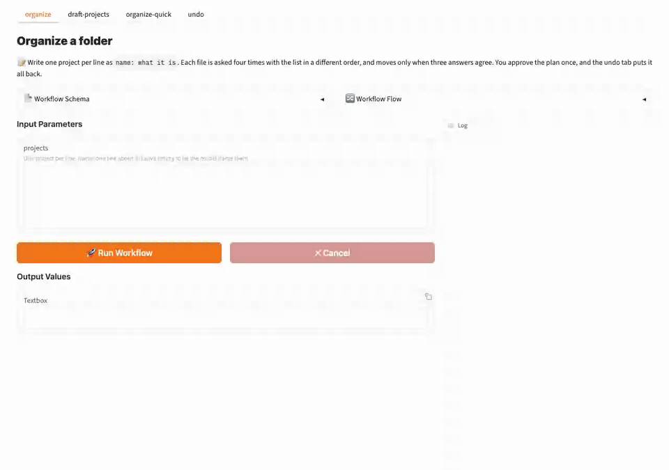
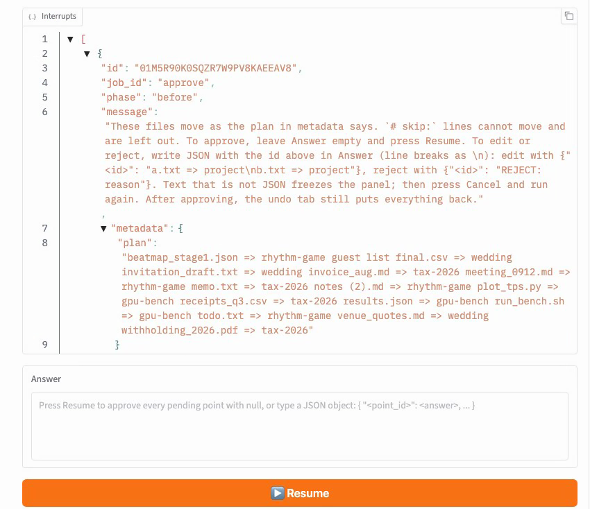
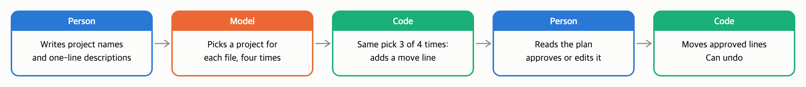
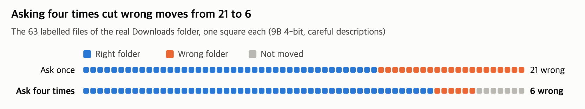
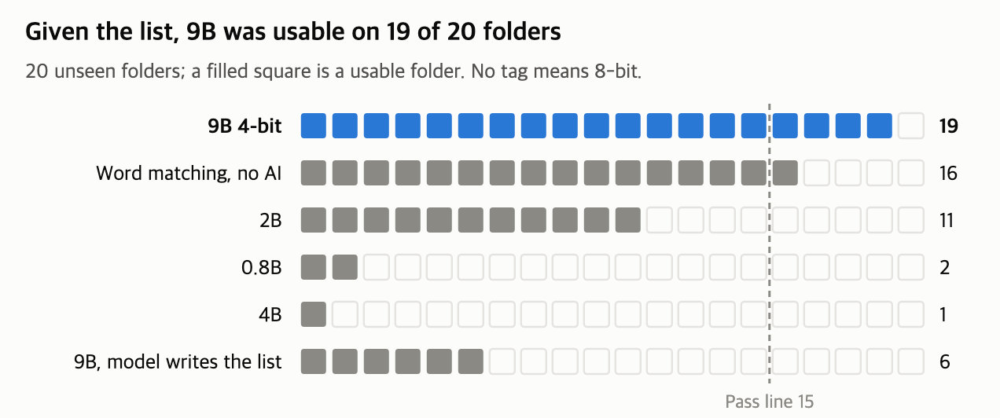
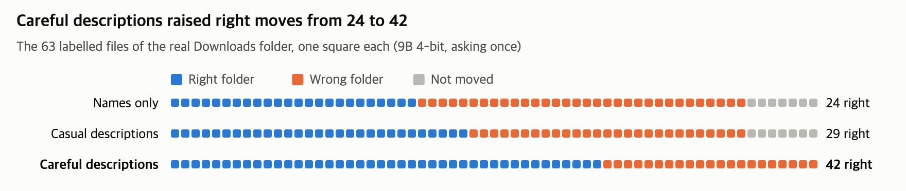
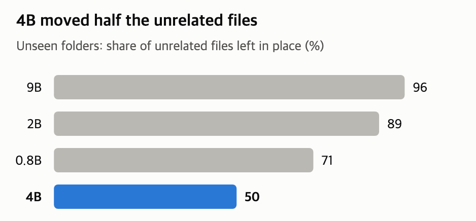
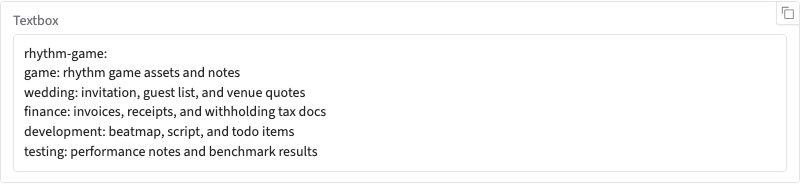

[English](README.md) · [한국어](README.ko.md) · [中文](README.zh-cn.md)

# file-sorting-qwen3.5

**Small Qwen models can sort a folder. They can't decide what to sort it by.**

A tool that sorts the files in a folder by project, with Qwen3.5 9B running on your own computer. Given a project name and a one-line description from a person, its plan could be approved after small fixes on 19 of 20 synthetic folders it had never seen (measured on an RTX 4090, with descriptions written while looking at the answers: a best case). Leave the list to the model as well, and even 9B (8-bit) managed 6 (the same 8-bit model given the list: 18).

The model picks a folder for each file, and nothing moves until a person approves the plan. Nothing is deleted, and moves can be undone.



The sample folder organized and undone with 9B at 4 bits on a 16GB Mac. The sample folder is one of the dev folders used while fixing the tool. All 14 moved files matched the answer key. The 3 min 13 s the model spends picking runs at 30x speed, the rest at 3x.

## Contents

- [Model](#model)
- [Quick start](#quick-start)
- [Summary](#summary)
- [Three methods you can reuse](#three-methods-you-can-reuse)
- [1 How it was tested](#1-how-it-was-tested)
- [2 Does it run on my machine?](#2-does-it-run-on-my-machine)
- [3 Results by feature](#3-results-by-feature)
- [4 Recommendations](#4-recommendations)
- [5 Limits and what was not measured](#5-limits-and-what-was-not-measured)
- [6 Smaller models](#6-smaller-models)
- [FAQ](#faq)
- [Repository layout](#repository-layout)
- [License](#license)

## Model

- **Model:** [Qwen3.5](https://huggingface.co/collections/Qwen/qwen35) 9B shrunk to 4 bits as a GGUF file (`Qwen3.5-9B-Q4_K_M.gguf` from [unsloth/Qwen3.5-9B-GGUF](https://huggingface.co/unsloth/Qwen3.5-9B-GGUF), 5.7GB). Thinking mode is not used.
- **Runtime:** [model-compose](https://github.com/hanyeol/model-compose) runs it with llama.cpp. It is a tool that starts models and a web page from one config file.
- **The main text reports 9B.** 0.8B, 2B, 4B and 2-bit were measured the same way and are collected in [section 6](#6-smaller-models).

## Quick start

You need
- macOS or Linux, Python 3.12 (check with `python3.12 --version`; if missing, `brew install python@3.12`)
- At least 6.9GB of free memory. Close large apps you aren't using. If swap fills up, it gets several times slower (section 2).
- On macOS, the Xcode Command Line Tools (`xcode-select --install`). llama-cpp-python is built during install.
- The first start downloads the 5.7GB model file.

**1. Install**

```bash
git clone https://github.com/MindrLabs/file-sorting-qwen3.5.git
cd file-sorting-qwen3.5
python3.12 -m venv .venv && source .venv/bin/activate
pip install -r requirements.txt   # pinned to model-compose 0.4.120, llama-cpp-python 0.3.36, torch 2.14.1, huggingface_hub 2.2.0
cp .env.sample .env                # the measured setting: 9B at 4 bits, 8K context. Without this line 4B at 8 bits loads
```

**2. Try it on the sample folder**

```bash
cp -R examples/sample-folder workspace    # sample folder (19 top-level files)
model-compose up
```

When the terminal shows `Uvicorn running on http://127.0.0.1:8081`, open http://localhost:8081. The four tabs at the top are `organize`, `draft-projects`, `organize-quick` and `undo`; the first, `organize`, opens.

1. Paste the three lines below into the `projects` box and press **Run Workflow**. If the box is empty, the model writes the list too, and results were much worse that way (3.1). The hint on the page, "Leave empty to let the model name them", means that case.

   ```text
   gpu-bench: GPU benchmark runs: results, run and plot scripts.
   tax-2026: 2026 taxes: receipts, invoices, and withholding statements.
   wedding: Wedding planning: guest list, venue quotes, and invitations.
   ```

2. After 2–3 minutes on a 16GB Mac, the plan appears under "Awaiting 1 answer". The `plan` value lists `file => folder` with no line breaks.
3. Press **Resume with the Answer box left empty** to approve. The files move and the result box lists them one per line. Files not in the plan stay where they are. You can check in Finder or with `ls -R workspace`.

   

4. To undo, press **Run Workflow** in the `undo` tab. Each press undoes one organize.

To reset the sample folder, run `rm -rf workspace && cp -R examples/sample-folder workspace`.

> The first tab asks about each file four times with the list order changed and moves it only when three or more answers agree ([method 2](#2-ask-several-times-with-the-order-changed-and-move-only-on-a-majority)). A folder of about 40 files took a median of 7 min 38 s on a 16GB Mac and about 20 seconds on an RTX 4090. If the page keeps showing Running, press Cancel, close other apps, and run it again.

**3. Use it on your own folder**

1. Stop the server (Ctrl+C), set `ORGANIZE_ROOT` in `.env` to the absolute path of the folder to organize, and start it again. The model cannot read or move anything outside this folder.

   ```bash
   ORGANIZE_ROOT=/Users/me/Downloads/sort-me    # start with a folder of a few dozen files
   ```

2. In the `projects` box, write your projects one per line as `name: description`. How to write a good line is in [method 1](#1-you-name-the-projects-with-a-one-line-description). If you don't know what to write, fix up the draft from the `draft-projects` tab. Most drafts need fixing ([FAQ](#what-is-the-point-if-a-person-writes-the-list)). The draft tab doesn't move files.
3. If the plan has many wrong lines, press **Cancel**. Nothing moves. Fixing the description and running again is easier than fixing the plan in JSON.

What gets organized
- Only top-level files. Files inside subfolders, hidden files and shortcuts (symbolic links) are left alone.
- With 6 or fewer top-level subfolders, all of them are candidate destinations. With more, only the folders you name in the `projects` box are.
- Files that aren't text, such as PDFs and images, are placed by name only.
- Each file is asked about separately, so time grows with the number of files: about 5 minutes for 100 files with 9B asking once on a Mac. Folders with hundreds of files were not measured.

<details>
<summary>Editing or rejecting a plan, the quick tab, the vote log, switching to 2B, ports</summary>

- **Approve with edits:** in the Answer box, write JSON keyed by the approval step's `id`. Example: `{"<id>": "a.txt => tax-2026\nb.txt => wedding"}`. Write line breaks as `\n`.
- **Reject:** `{"<id>": "REJECT: reason"}`
- **If the page stops moving after you put other text in the Answer box,** press Cancel and Run again.
- **Faster:** the `organize-quick` tab asks once. It takes about 2 minutes on a Mac, but on the real Downloads folder it was not usable (3.4).
- **Why a file stayed put:** each file's four answers are written to `.organizer/votes/` in the folder, one line per file. You can see split answers (a project name or `none`) or answers that named nothing on the list (`null`, with the model's reply as written beside it).
- **Existing folders:** a description attached to one is not used. Rename folders whose names don't say what's inside first (not measured).
- **Switching to 2B:** change three lines in `.env` (`LLM_REPO`, `LLM_GGUF`, `LLM_REVISION`) to the 2B values in the `.env.sample` comments. `LLM_REVISION` is the commit of the model file used in the measurements. The file is 1.3GB, memory 2GB, a little over 30 seconds per folder on a Mac (asking once). But it was usable on fewer than half of the unseen folders, and on only 1 of the 4 dev folders measured on a Mac ([section 6](#6-smaller-models)).
- **Sharing results from a rerun:** `python3 tools/env_report.py [model.gguf]` writes out the versions and the model file.
- **Ports:** the web page is 8081 and the API 8080. Both listen only on this computer (127.0.0.1), the model-compose 0.4.120 default. Change them with `SERVER_PORT` and `PORT` in `.env`.

</details>

## Summary

From here on it is measurement results. If you only want to use the tool, [Three methods you can reuse](#three-methods-you-can-reuse), [4 Recommendations](#4-recommendations) and the [FAQ](#faq) are enough.

- A "usable folder" is one where the model's first plan could be approved after fixing at most one line in five. A scoring program that holds the answer key (the stand-in reviewer) judged that ([section 1](#1-how-it-was-tested)).
- "Unseen folders" (held out) are 20 synthetic folders whose contents the measuring side never saw, used only after the measuring tools were final.
- "Pair F1" (0–1) scores whether files of the same project ended up in the same folder. 1 means the same grouping as the answer key.
- A model without a quantization tag is 8-bit (Q8_0); 4-bit is the Q4_K_M file. Every 9B measured on the real folders is 4-bit. [ ] is a Wilson 95% interval.

1. **Given the project list with descriptions, 9B at 4 bits was usable on 19/20 unseen folders ([76, 99]).** When the model also wrote the list, even 9B reached only 6/20. [3.1](#31-giving-the-list-vs-leaving-it-to-the-model)
2. **A one-line description changed the result.** On the real Downloads folder, 9B scored a pair F1 of 0.32 with project names only and 0.46 with descriptions written after reading the file names (careful). [Method 1](#1-you-name-the-projects-with-a-one-line-description)
3. **Asking four times with the list order changed, and moving only on a majority, cut wrong moves.** On the real Downloads folder, files sent to the wrong folder fell from 21 to 6 (one folder, one run). It takes 2.4–2.5 times as long. [3.2](#32-asking-four-times-and-taking-the-majority)
4. **9B at 4 bits ran in at most 6.9GB on a 16GB Mac.** Per folder, asking once took about 2 minutes and asking four times a median of 7 min 38 s (with no swap in use). [Section 2](#2-does-it-run-on-my-machine)
5. **9B gave the same results at 4 bits as at 8 bits.** [3.5](#35-quantization)
6. **A folder with nothing to organize could not be left to it.** On a Desktop copy (30 files) where everything should stay, with the list also left to the model, even 9B at 4 bits tried to move 25. [3.3](#33-picking-and-leaving-alone)
7. **A baseline with no AI also passed on the synthetic folders (TF-IDF 16/20).** No difference from 9B at 4 bits could be claimed. On the real Downloads folder it was not usable. [FAQ](#wouldnt-word-matching-like-tf-idf-be-enough)
8. **No file was lost during measurement.** In all 4,983 measurement runs, undoing right after organizing put every file back as it was. [Method 3](#3-preview-and-undo)

**Reading these numbers**

- 19 is a best-case number. The project descriptions were written while looking at the answer key, and approval was judged by a scoring program that holds the answer key. A person reviewing may approve fewer ([1.1](#11-can-the-stand-in-reviewer-be-trusted)). The recommended setting (9B at 4 bits, asking four times) is a cell added after seeing other settings' results (section 5).
- There are two real folders, and each setting was measured once on them. On the real Downloads folder, it was usable only with careful descriptions plus asking four times ([3.4](#34-the-real-downloads-folder)).
- It fits a folder of a few dozen files whose projects you already know. It does not fit when you don't yet know how to split the folder, or when there is little to organize ([FAQ](#what-is-the-point-if-a-person-writes-the-list)).

Table 1: Recommended settings (names and descriptions given; the real Downloads column uses careful descriptions)

| Setting | Model file | Memory (16GB Mac) | Mac, one folder | RTX 4090, one folder | Usable unseen folders | Real Downloads (measured once) |
|---|---|---|---|---|---|---|
| **9B Q4_K_M, asking four times (first tab)** | 5.7GB | 6.9GB | 7 min 38 s | about 20 s | **19/20 = 95% [76, 99]** | usable (lines to fix 9.4%) |
| 9B Q4_K_M, asking once | 5.7GB | 6.5GB | about 2 min | about 8 s | 19/20 = 95% [76, 99] | not usable (lines to fix 32.8%) |

- One folder is about 40 files. Times are medians from request to answer and leave out the first model load. Memory is the largest value over folders.
- On the Mac, swap did not grow while either line was measured (asking four times: 0 before and after). With swap filling up it gets much slower (section 2).
- The unseen folders were measured with a 65K context, and time and memory with 8K. First plans at the two contexts were compared only for asking once on the dev folders, and they matched.
- Memory counts 1GB as 1024MB. 2B at 4 bits is in [section 6](#6-smaller-models).

## Three methods you can reuse

These are the three methods this tool uses. The first was checked by measurement. The second cut wrong moves but also the files moved, and it raised 9B's usable folders only once, on the real folder. The third is a safety net. You could try the same structure on other sorting jobs, but this repo only measured files.



Figure 1: How the folder organizer works. The name on top of each box is who handles that step.

### 1. You name the projects, with a one-line description

On the unseen synthetic folders, 9B was good at "does this file belong to this project?" (95% sent to the right given folder). But it could not find "what projects are in this folder?" (3.1). So a person provides the project list. Don't give names alone; add a one-line description.

| Weaker line | Better line |
|---|---|
| `garden` | `garden: seed orders, bed layout, tomato seedlings` |
| `tax` | `tax-2026: 2026 taxes: receipts, invoices, and withholding statements.` |
| `misc: other files` | Leave it out. Files that fit nowhere stay where they are without it |

- In the description, use words that actually appear in that project's files: people, places, kinds of documents.
- For a folder that already exists, use its name as is. A new name splits the same project across two folders. A description attached to an existing folder is not used.
- On the real Downloads folder, 9B got 13 more files right with descriptions written after reading the file names ("careful") than with 3–6 word descriptions written from the project names alone ("casual"): 42 vs 29 of 63. Casual descriptions did about as well as names only (pair F1 0.31 vs 0.32).

### 2. Ask several times with the order changed, and move only on a majority

For each file, the same question is asked four times with only the list order changed. If the same project is picked three or more times out of four, the file moves; otherwise it stays. With fewer than four candidates, it asks as many times as there are candidates and moves only when all answers agree. The "three or more" threshold was not tuned to the data. The rest of the rule was built on the dev folders (section 5).

Asking several times and following the majority ([self-consistency](https://arxiv.org/abs/2203.11171)) and asking several times with the list order changed ([permutation self-consistency](https://arxiv.org/abs/2310.07712)) are known methods. This tool uses both, and does not move a file when no majority forms.



Figure 2: Asking four times left the 7 files it was unsure of unmoved. One folder, one run. On the 20 unseen folders the lines to fix fell from 8.3% to 4.3% and the usable share stayed the same (table 4).

- It asks four times as often, so it takes 2.4–2.5 times as long (total on the 4090).
- Files it is unsure of are not moved, so fewer files move. On the real Downloads folder, 9B left 7 of the 63 files with an answer in place. So lines to fix alone make the effect look bigger than it is (3.4).
- The effect was different on smaller models ([section 6](#6-smaller-models)).

### 3. Preview and undo

- The model cannot move files itself. Code gathers the model's picks into a plan, and code moves files according to the plan the person approved.
- Files are never deleted or overwritten. If a file with the same name exists at the destination, that line is skipped. Every move is logged, and `undo` reverts organizes one at a time, starting from the latest. In all 4,983 measurement runs, every file was back as it was after undo. The runs repeat the same folders, so they are not independent trials. Permission problems, cloud-synced folders, and undoing after editing organized files were not tested.
- The approval screen alone doesn't catch every wrong line. When the author reviewed plans by hand, about one in six wrong lines looked right to a person too (small sample, [1.1](#11-can-the-stand-in-reviewer-be-trusted)).

## 1 How it was tested

How to check
- Every table can be regenerated with intervals by `python3 scripts/report_tables.py`.
- Which result file backs which table: [results/README.md](results/README.md)
- How to rebuild the folders and measure again, and check that first plans are byte-identical by hash: [measure/README.md](measure/README.md)
- The registered predictions and the record of changes: [docs/preregistration.md](docs/preregistration.md)

Terms used in this report:

- **Usable folder (usable run):** the first plan can be approved after small fixes. All four must hold: lines to fix at most 20%, at least 60% of the files with an answer moved, folders already organized left untouched, and it stops at the end. The stand-in reviewer judges approval. Since moving 60% of the files with an answer is enough, a usable folder can still have files left unmoved.
- **Pass:** at least 15 (75%) of the 20 unseen folders are usable. That is where the lower bound of the 95% confidence interval of the usable share reaches 0.5, so passing means the usable share can be said to be above half. 9B at 4 bits has 19 of 20, so its lower bound is 76%. The usable share is cut at thresholds, so it can swing a lot on small differences in pair F1.
- **Lines to fix:** lines the stand-in reviewer fixed or deleted in the first plan ÷ lines in the plan. An ambiguous file that could belong to either of two projects is left out of scoring (both numerator and denominator). Written to one decimal place. Also, for each project, the folder most of its files went to counts as that project's folder. So moving a whole project into a folder with a different name still counts as right.
- **Pair F1 (pairwise F1, 0–1):** a score from counting pairs: whether two files of the same project went to the same folder. 1 means the same grouping as the answer key. A project with only one file has no pairs, so it barely registers. Models are compared by taking differences on the same folders and resampling folders for a 95% interval. If the interval leaves out 0, it says "different"; if it includes 0 and lies entirely within ±0.05, "same"; otherwise "can't tell".
- **Stand-in reviewer:** a program that holds the answer key (an oracle). In place of a person, it fixes the wrong lines of the first plan and approves it. It doesn't fix ambiguous files.

Accuracy on the unseen and dev folders was measured on an RTX 4090, and the real folders on a 16GB Mac. The full conditions for folders, descriptions, engine, baselines and flows are folded below.

<details>
<summary>All test conditions</summary>

| Item | Details |
|---|---|
| Unseen folders | 20 synthetic judgment folders. The measuring side did not see their contents. Used once per setting after the flow was frozen; the 9B 4-bit cell and the asking-four-times cell were added after seeing other cells' results (section 5). Each folder has 39–48 files and 4–6 projects |
| Dev folders | 12 synthetic folders used while fixing the tool, made the same way as the unseen folders. 37% of the files belong to no project and should stay. The quick start's sample folder (`examples/sample-folder`) is a dev folder used before these |
| How the synthetic folders were made | Projects, file names and where clue sentences sit were designed apart from the measuring side, and a fixed-seed generator wrote the files. Text files are filled with paragraphs unrelated to the projects, with a clue sentence in one of three places: within the first 300 characters, between 300 and 2,000 characters, or after 2KB. Non-text files are a real format header plus random bytes, so their contents can't be read |
| Project descriptions | Written per folder while looking at the answer key and the file names and openings. Shaped as "what it is: 3–4 things that go in it", at most 90 characters, and not allowed to copy file names. Existing folders got no description. A best case: someone who knows their projects well writing them down once |
| Real folders | A copy of the 70 most recent files from the author's Downloads folder (19 projects, answers set by the author) and a Desktop copy (30 files, all of which should stay). Both sets of Downloads descriptions (careful and casual) were also written while looking at the answer key |
| Machines | Accuracy on the unseen and dev folders was measured on an RTX 4090 (24GB), the real folders on a 16GB Mac (Apple M2). Memory and time on both |
| Engine and settings | llama.cpp (llama-cpp-python), model-compose. Thinking mode not used. Context is 65K for the unseen folders and 8K for the recommended setting measured on the Mac. Measurements used a model-compose build (based on 0.4.120) that passes presence_penalty and min_p to llama.cpp. PyPI 0.4.120 does not pass these two values. On 4 dev folders measured on the Mac (2B and 9B at 4 bits, asking once), the 8 first plans were identical across the two builds (this comparison is in the working notes only, not in results/) |
| Repeats | Once per folder. Rerunning with the same settings on the same machine gave byte-identical first plans. The Mac and the 4090 could give different first plans with the same model file and settings. Their builds differed too (section 5) |
| What the model sees | For each file, its name and, for text files, the first 300 characters, plus the project list. Even when a person gives the list, the model sees the folder's file listing once in the project step, cut to 160 characters per file |
| Baselines | TF-IDF word matching with no AI, and a 0.6B embedding (Qwen3-Embedding-0.6B). They get the same list as the model and read each file's name and the first 2KB of text files (more than the model sees). Each file goes to the most similar project and stays if the similarity is below a threshold. The threshold is the value with the highest pair F1 on the dev folders, and the same value was used on the real folders |
| Flows | **Step-by-step** (this tool): code sets the order and the model only picks for each file. **Tool agent**: the model drives itself, choosing tools (list the folder, preview, read, suggest groups, set the list, assign, submit). Compared in 3.6 and section 6 |

</details>

### 1.1 Can the stand-in reviewer be trusted?

The author fixed some plans by hand without seeing the stand-in reviewer's calls, and compared. The sample is small (section 5).

- The person also fixed 83% of the lines the stand-in reviewer fixed. The remaining one in six or so were wrong lines that looked right to the person, who left them.
- Instead, the person deleted more lines they couldn't be sure of from the name alone. So the "lines to fix 20%" bar is more lenient than a careful person. With a real person reviewing, usable folders may be fewer than this report's numbers.

## 2 Does it run on my machine?

This tool asks the model many short questions, so it doesn't need a long context. Rerunning the dev folders with asking once and the context cut from 65,536 to 8,192 gave byte-identical first plans for 9B at 4 bits (2B and 4B too; asking four times was not compared). Memory dropped a lot.

Table 2: Memory and time for 9B Q4_K_M (memory is the largest over folders, times are medians, 1GB = 1024MB)

| | RTX 4090 | 16GB Mac |
|---|---|---|
| Memory, 65K context | 9.5GB | not measured |
| Memory, 8K context | 6.0GB | 6.5GB (asking four times 6.9GB) |
| One folder, asking once | 8 s (8–10 s) | 2 min (1 min 31 s to 2 min 49 s) |
| One folder, asking four times | 20 s (18–24 s) | 7 min 38 s (5 min 02 s to 10 min 46 s) |

- Not measured: M1, M3 and M4 Macs, 8GB machines, Windows, phones. Memory should fit on other 16GB Apple Silicon Macs, but speed may differ.

<details>
<summary>Swap, DGX Spark, 27B and other details</summary>

- For asking once on the Mac, swap was 3.9GB both before and after, so it did not grow during the measurement.
- Asking four times on the Mac was measured with other apps closed, and swap was 0 before and after. Measured while swap grew from 7.6GB to 13.3GB, the 3 folders that finished took a median of 10 min 19 s and one folder did not finish because a tool command hit its time limit.
- When the real Downloads folder (70 files) was measured, about 8GB of swap was in use; 9B took 10 min 30 s asking once and 23 min 36 s asking four times.
- The Mac and the 4090 could give different first plans with the same model file and settings (section 5). On the 4 dev folders measured on the Mac, 9B at 4 bits was usable on all 4 asking once and on all 4 asking four times.
- On an NVIDIA DGX Spark (GB10), only time was measured, once each on the sample folder (19 top-level files) with the demo's list: asking once took 10 s and asking four times 20 s. The run was polled every 2 seconds, so each time is up to 2 s high. This is not the dev folders of Table 2, memory was not measured, and the plans were not scored. It used model-compose 0.4.120 from PyPI, which does not pass `presence_penalty` and `min_p` (`.env.sample`).
- 27B at 4 bits (16.7GB), run with the tool agent flow and a 65K context on the 24GB GPU, stopped with a CUDA error during its first run. Whether memory ran out was not checked, and as registered it was not rerun with a smaller context.
- Memory and time for smaller models are in [section 6](#6-smaller-models).

</details>

## 3 Results by feature

### 3.1 Giving the list vs leaving it to the model

Given the list and descriptions, 9B passed at both 4 and 8 bits (19 and 18), and so did TF-IDF with no AI (16). When the model also wrote the list, even 9B reached 6.



Figure 3: Picked from tables 3 and 8. The pass line is 15 of 20.

<details>
<summary>Table 3 and statistics</summary>

Table 3: Usable folders out of 20 unseen folders (step-by-step, 65K context)

| Setting | Usable folders |
|---|---|
| 9B 4-bit, names and descriptions | **19/20 = 95% [76, 99] (pass)** |
| 9B 4-bit, names and descriptions, asking four times | **19/20 = 95% [76, 99] (pass)** |
| 9B 8-bit, names and descriptions | **18/20 = 90% [70, 97] (pass)** |
| TF-IDF (no AI), names and descriptions | **16/20 = 80% [58, 92] (pass)** |
| 9B 8-bit, model writes the list | 6/20 = 30% [15, 52] |

- The pass line is an interval lower bound of 50% (15 or more of 20). 9B at 8 and 4 bits differ by one folder, so neither can be called better.
- Giving the list raised 9B 8-bit from 6 to 18 (McNemar, Holm p 0.004). Pair F1 is different too: +0.135 [+0.077, +0.203].
- No difference between 9B 4-bit and TF-IDF could be claimed (19 vs 16, Holm p 1.0). The pair F1 difference, −0.007 [−0.090, +0.082], is can't tell.
- Common mistakes in lists the tool agent wrote (dev folders) were catch-all folders such as "other" or "misc" and a second folder for an existing one under another name, which split one project across two folders.
- The full table, including 0.8B, 2B, 4B and the 0.6B embedding, is in [section 6](#6-smaller-models).

</details>

### 3.2 Asking four times and taking the majority

Asking four times made the real Downloads folder usable (lines to fix 32.8% → 9.4%). On the unseen folders, lines to fix fell from 8.3% to 4.3% and usable folders stayed at 19.

<details>
<summary>Table 4 and statistics</summary>

Table 4: Asking once → asking four times (9B 4-bit, names and descriptions; unseen folders at 65K context, the rest at 8K)

| Folders | Usable folders | Lines to fix | Files that should stay but moved | Pair F1 |
|---|---|---|---|---|
| Unseen folders | 19/20 → 19/20 | 8.3% → 4.3% | 15 → 6 | 0.63 → 0.64 |
| Dev folders | 12/12 → 12/12 | 6.3% → 4.1% | 11 → 7 | 0.67 → 0.69 |
| Real Downloads | no → **yes** | 32.8% → 9.4% | 4 → 3 | 0.46 → 0.84 |

- On the unseen folders no difference between the two can be claimed (Holm p 1.0). The pair F1 difference is +0.003 [−0.010, +0.017], same.
- Pair F1 values can't be compared across kinds of folders. Synthetic and real folders differ in the number and size of projects.
- On the unseen folders, the share of right pairs among the pairs 9B moved (pair precision) rose from 0.81 to 0.89, and the share of files with an answer that it moved fell from 0.78 to 0.74.
- 2B and 4B results are in [section 6](#6-smaller-models).

</details>

### 3.3 Picking and leaving alone

On the unseen folders, 9B sent 95% or more of files to the right given folder and left 95% or more of unrelated files in place.

A folder with nothing to organize is harder. On a real Desktop copy holding 30 files that should all stay, with the list also left to the model, even 9B at 4 bits tried to move 25. A list from a person was not measured there. Smaller models tried to move almost every file in this folder ([section 6](#6-smaller-models)).

<details>
<summary>Table 5</summary>

Table 5: Average over the 20 unseen folders (names and descriptions given)

| Model | Sent to the right given folder | Unrelated files left in place |
|---|---|---|
| 9B | 95% [93, 97] | 96% [92, 98] |
| 9B 4-bit | 96% [93, 98] | 95% [92, 98] |

[ ] is a 95% interval from resampling folders. 9B picked the given folders well and left almost all unrelated files in place.

</details>

### 3.4 The real Downloads folder

It has many projects (19), more than half of them with only 1–2 files, and many whose names don't say what they are. It is much harder than the synthetic folders with 4–6 projects. Projects with a single file barely register in pair F1.

Only careful descriptions plus asking four times were usable (lines to fix 9.4%). Neither baseline (TF-IDF, embedding) was usable in any cell.



Figure 4: The folder of table 6, asking once. Careful descriptions were written after reading the file names; casual ones from the project names alone.

<details>
<summary>Tables 6 and 7, and how they count</summary>

Table 6: First plans on the real Downloads folder (Mac, 9B 4-bit, 8K context, 63 files with an answer)

| Setting | Right folder | Wrong folder | Not moved | Pair F1 | Lines to fix | Usable? | Files a person must handle |
|---|---|---|---|---|---|---|---|
| Careful descriptions, asking four times | 50 | 6 | 7 | 0.84 | 9.4% | **yes** | 16 |
| Careful descriptions | 42 | 21 | 0 | 0.46 | 32.8% | no | 25 |
| Casual descriptions | 29 | 27 | 7 | 0.31 | 38.9% | no | 37 |

- Careful descriptions were written after reading the file names and name kinds of documents; casual ones are 3–6 words written from the project names alone. Both were written while looking at the answer key.
- Right folder, wrong folder and not moved count the 63 files with an answer. Lines to fix follow the stand-in reviewer, which counts differently: ambiguous files (6 in this folder) are not counted, and the folder most of a project's files went to counts as that project's folder. Lines that moved a whole project into a differently named folder count as right, so the rate is lower than one computed from the wrong-folder count.
- Files a person must handle = wrong folder + files that should stay but were moved + files not moved.
- Asking once was measured with the measurement build and asking four times with PyPI 0.4.120. The PyPI release does not pass presence_penalty and min_p to llama.cpp, so the two runs' sampling settings differ slightly (section 1).

Table 7: Same folder, same list as the model: 9B at 4 bits vs the baselines (pair F1; lines to fix in parentheses)

| | Names only | Careful descriptions | Casual descriptions |
|---|---|---|---|
| 9B 4-bit, asking four times | not measured | **0.84 (9.4%)** | not measured |
| 9B 4-bit, asking once | 0.32 (35.2%) | 0.46 (32.8%) | 0.31 (38.9%) |
| 0.6B embedding | 0.49 (35.9%) | 0.40 (32.7%) | 0.36 (38.5%) |
| TF-IDF | 0.14 (24.0%) | 0.23 (22.6%) | 0.14 (26.9%) |

- One folder, one run, so there are no intervals. "Higher" below just puts numbers side by side; it is not a tested difference.
- No baseline cell was usable. TF-IDF had the fewest lines to fix but moved only 37–47% of the files with an answer, short of the 60% bar. The embedding had 32.7–38.5% lines to fix.
- With names only, the 0.6B embedding (0.49) scored higher than 9B asking once (0.32). But it moved every file with an answer, and lines to fix were 35.9%.
- With careful descriptions, 9B rose from 0.32 to 0.46. Among the baselines, TF-IDF rose from 0.14 to 0.23 and the embedding fell from 0.49 to 0.40. With casual descriptions too, the embedding (0.36) scored higher than 9B asking once (0.31).
- The baselines' only way to hold back when unsure, as asking four times does, is one threshold, and that threshold was set on the synthetic dev folders.
- 2B results on the real Downloads folder are in [section 6](#6-smaller-models).

</details>

### 3.5 Quantization

Shrinking 9B from 8 to 4 bits left pair F1 the same: +0.003 [−0.011, +0.016] (20 unseen folders, paired by folder). The usable folders, 18 and 19, can't rank them either. 2B, 4B and 2-bit are in [section 6](#6-smaller-models).

### 3.6 Flow: code sets the order vs the model picks tools

The two flows were compared with the model also writing the list. For 9B, the step-by-step flow, where code sets the order, scored a pair F1 +0.09 [+0.01, +0.18] higher than the tool agent. But in this condition both fell far short of passing (tool agent 1/20 = 5%, step-by-step 6/20 = 30%). 2B and 4B are in [section 6](#6-smaller-models).

## 4 Recommendations

- **Write the project names and one-line descriptions yourself.** Put words that actually appear in the files into the descriptions.
- **On a 16GB laptop: 9B Q4_K_M, 8K context, the first tab (asking four times).** Close other apps while it runs. With no swap in use a folder took a median of 7 min 38 s; with swap filling up, one folder did not finish. Asking once is faster but was not usable on the real Downloads folder. The reason asking four times is the default is that one run on that real folder. On the unseen folders the usable share was unchanged.
- **4 bits was enough for 9B.** For a lighter model (such as 2B), see [section 6](#6-smaller-models) before choosing. 2B at 4 bits was usable on only 45% of the unseen folders.
- **Don't rely on the approval screen alone; use undo.** Some wrong lines looked right to a person too.
- **Don't hand it a folder with little to organize (such as a Desktop).** With the list also left to the model, even 9B at 4 bits tried to move most files.

## 5 Limits and what was not measured

- **The judgment folders are synthetic.** Projects, file names and clue positions were designed apart from the measurement, but the file contents came from the same generator as the dev folders. So they answer "an unseen design" but not "an unseen kind of folder". On the synthetic folders, TF-IDF with no AI also passed.
- **The project descriptions were written while looking at the answers.** On the unseen folders that is the best case. On the real Downloads folder too, descriptions the owner wrote without the answer key were not measured.
- **The unseen folders were used more than once.** Each setting used them once after the flow was frozen, but the 9B 4-bit cell was added after seeing the 9B 8-bit result (18), and the asking-four-times cell after seeing the 2B 4-bit result (9). The asking-four-times rule was set on the dev folders only and measured once on the unseen folders with 9B. So these two cells are not fully unseen.
- **There are two real folders, run once per setting.** Asking four times becoming usable on the real Downloads folder (wrong moves 21 → 6) is one folder and one run. It is a case, not a statistical claim. Casual descriptions with asking four times, and a list from a person on the Desktop, were not measured.
### Other limits

- **Variation across reruns and list orders is not covered.** Rerunning on the same machine gave the same first plan, so each folder was run once, without changing the sampling seed or the list order. As the effect of asking four times shows, the answer from asking once can change with the list order.
- **Results can differ between the Mac and the 4090.** On 4 dev folders with the same model file and settings, 9B's first plans from asking once differed in 2 folders (asking four times: 1 folder). The two machines ran different llama.cpp and model-compose builds, and for asking four times a different revision of the config file too. So whether the difference comes from the machine or the build can't be told apart. So the rates measured on the 4090 can't be said to hold on a Mac. On the Mac too, asking once was usable on all 4 folders and asking four times on all 4.
- **Sample sizes.** Unseen folders: 20 folders, once each (9B 4-bit 19, 9B 18, TF-IDF 16, 9B with the model's list 6). The dev comparison of asking four times: 12 folders, once each (9B 12 → 12). Mac times: 4 dev folders each.
- **The person check is one person, the author, on 8 plans (166 lines).** Of the 59 lines the stand-in reviewer fixed, the person also fixed 49, and 10 of those 59 wrong lines looked right to the person. How many fewer folders would be usable by a person's standard was not counted.
- **The draft list was measured once, on the real Downloads folder.** 9B's draft had about 4 of the 19 projects in usable form; 3 lines lumped different projects together, and 8 were missing. The draft is set to give 2–8 projects, so in a folder with many projects it catches only some.
- **The baselines hold back with one threshold only.** The threshold set on the synthetic dev folders was used as is on the real folders. A baseline with a hold-back mechanism to match asking four times, and grouping with embeddings while the model only names the groups, were not measured.
- **Scale and time.** Folders of more than a few hundred files, and a comparison with the time a person takes to organize by hand, were not measured. Nor were the time and memory of the baselines (TF-IDF, embedding).
- **Non-text files were not scored separately.** The accuracy on files placed by name only, such as PDFs and images, was not broken out.
- **There is only one answer grouping.** A split that differs from the answer key but makes sense still counts as wrong. The ceiling, a list a person made without the answer key and scored the same way, was not measured.
- **Only the Qwen3.5 family was measured, with thinking mode off.** No other family was compared.
- **Versions.** A different model-compose or llama.cpp version can give different output for the same input. Unlike the measurement build, PyPI 0.4.120 does not pass presence_penalty and min_p (the 8 first plans of 2B and 9B at 4 bits on 4 dev folders measured on the Mac were identical across the two builds; this comparison is in the working notes only, not in results/). Differences by file-name language (Korean, English) were not examined either.
- **Training (fine-tuning) is out of scope.** The question was how far a model works as downloaded.

<details>
<summary>Predictions written before the results, and results</summary>

| Prediction | Result |
|---|---|
| With the model writing the list, everything fails and 9B is highest | Half right: all failed, but in the tool agent 4B 4-bit (2) beat 9B (1) |
| With names and descriptions, 2B fails (8–14 of 20) | Right (11) |
| With names and descriptions, 9B is borderline | Wrong: passed with 18 |
| 2B is poor at leaving unrelated files alone | Wrong: it left 89% in place |
| The baselines (TF-IDF, 0.6B embedding) don't pass, and their pair F1 is lower than 2B's | TF-IDF wrong on both (passed with 16; pair F1 higher than 2B's). Embedding right on both (6; pair F1 lower than 2B's) |
| In the tool agent, 4B 4-bit vs 8-bit: can't tell | Right (−0.013, can't tell) |
| In the tool agent, 4B 2-bit falls below 8-bit | Right (−0.24) |
| In the step-by-step flow, 4B 2-bit vs 8-bit: can't tell | Wrong: it fell by 0.05 |
| Asking four times raises 2B's usable folders | Wrong: wrong moves fell, but so did moved files, so it stayed the same |
| With asking four times, 9B holds its level | Right |

Predictions about the 9B 4-bit result, the 8K context, and Mac memory and time were left out: they were recorded together with the results, so they can't count as made before the results. Registration times and the record of changes are in [docs/preregistration.md](docs/preregistration.md).

</details>

## 6 Smaller models

0.8B, 2B, 4B and 2-bit were measured on the same folders with the same flows as 9B. These comparisons were preregistered, so they are kept and collected in this section. All the numbers can be regenerated from [results/](results/README.md) with `python3 scripts/report_tables.py`.

- **Giving the list helped at every size. Still, only 9B produced usable plans consistently.** With the list also left to the model: 0.8B 0%, 2B and 4B 5%. In separate probes on dev folders, 4B and up found projects shared by several files (0.8B and 2B did not).
- **It doesn't follow size.** Given the list, 2B reached 55% and 4B 5%. 0.8B reached 10% even with the list.
- **A candidate reason 4B scores below 2B: it moves unrelated files too.** 4B left only 50% of unrelated files in place (2B 89%, 9B 96%). On the Desktop copy too, 4B at 4 bits tried to move all 30 files. This reading rests on a correlation only, so it is not claimed as the cause. Since no other family was compared, it also can't tell whether this is a property of 4B itself or a poor fit with this flow.
- **Quantization:** 9B and 4B held at 4 bits; 2B at 4 bits and 4B at 2 bits dropped.

Table 8: Usable folders out of 20 unseen folders, all sizes (step-by-step, 65K context)

| Model | Model writes the list | Names only | Names and descriptions |
|---|---|---|---|
| 0.8B | 0/20 = 0% [0, 16] | — | 2/20 = 10% [3, 30] |
| 2B | 1/20 = 5% [1, 24] | 3/20 = 15% [5, 36] | 11/20 = 55% [34, 74] |
| 4B | 1/20 = 5% [1, 24] | 0/20 = 0% [0, 16] | 1/20 = 5% [1, 24] |
| 9B | 6/20 = 30% [15, 52] | — | 18/20 = 90% [70, 97] (pass) |
| 2B 4-bit | 0/20 = 0% [0, 16] | — | 9/20 = 45% [26, 66] |
| 4B 4-bit | 1/20 = 5% [1, 24] | — | 1/20 = 5% [1, 24] |
| 4B 2-bit | 0/20 = 0% [0, 16] | — | 2/20 = 10% [3, 30] |
| 9B 4-bit | — | — | 19/20 = 95% [76, 99] (pass) |
| TF-IDF (no AI) | n/a | 10/20 = 50% [30, 70] | 16/20 = 80% [58, 92] (pass) |
| 0.6B embedding | n/a | 9/20 = 45% [26, 66] | 6/20 = 30% [15, 52] |

- "—" is a cell not measured. Giving the list raised pair F1 at every size (0.8B +0.13, 2B +0.16, 4B +0.10, 2B 4-bit +0.15, 4B 4-bit +0.11, 4B 2-bit +0.07, all different). For 4B, pairing improved but usable folders did not.
- 2B went from 3 with names only to 11 with descriptions added (McNemar p 0.008). TF-IDF rose with descriptions, but the 0.6B embedding fell. The reason was not examined.
- By pair F1, TF-IDF scored higher than 2B (−0.13) and 4B (−0.21), both different.



Figure 5: The 8-bit rows of table 9.

<details>
<summary>Table 9: Picking and leaving alone, all sizes</summary>

Table 9: Picking and leaving alone, all sizes (average over the 20 unseen folders, names and descriptions given)

| Model | Sent to the right given folder | Unrelated files left in place |
|---|---|---|
| 0.8B | 82% [77, 86] | 71% [62, 79] |
| 2B | 92% [88, 95] | 89% [83, 94] |
| 4B | 86% [82, 89] | **50% [44, 57]** |
| 9B | 95% [93, 97] | 96% [92, 98] |
| 2B 4-bit | 91% [87, 94] | 81% [74, 88] |
| 9B 4-bit | 96% [93, 98] | 95% [92, 98] |

4B was a little below 2B at picking too, but both cleared the preset bar (interval lower bound 80%); the big split was in leaving alone. 0.8B fell short of the bar even at picking. On the Desktop copy (30 files that should all stay), the first plans tried to move 29 (2B), 30 (4B 4-bit) and 25 (9B 4-bit) files (2B and 4B at 65K context, 9B at 8K).

</details>

<details>
<summary>Steps: each passed or failed on its own</summary>

- Each step is passed or failed on its own. A folder that fails one step is still counted on the next, so the steps are not climbed one after another.
- The steps: 1 called a tool at least once. 2 gave a plan with no unreadable line. 3 of the files you can tell by name, every one it moved went to the right folder, and it moved at least 60%. 4 the same for files you have to open. 5 moved no file that has no answer or already sits in an organized folder. 7 made at most two tool calls after the last move. Step 6 (taking a rejection) is measured only when a plan is rejected, so it is left out.
- Steps 3, 4 and 5 fail on a single mistake, so they are strict. A usable folder allows up to 20% of lines to fix, so it does not need to pass all of them.
- Step 4 was 0–1 on every row. In the step-by-step flow the model sees only the first 300 characters of a text file, and the clue sentence is often further in (on the dev folders, 36% of the files you have to open have the clue within the first 300 characters). 9B 4-bit failed step 4 and was still usable on 19.
- The settings differed at steps 3 and 5. In the step-by-step flow, steps 1, 2 and 7 were 20 on every row. Only the tool agent, where the model decides when to finish, failed step 7, on 11. 4B passed step 3 on 10 but step 5 on none (figure 5).
- TF-IDF is not a model that writes a plan, so it has no steps 1–4 or 7 (step 5: 14, usable folders: 16).

Every step, all settings (unseen folders passed, of 20)

| Setting | 1 Tool call | 2 Plan format | 3 Group by name | 4 Group by opening | 5 Leave the rest alone | 7 Stop | Usable folders |
|---|---|---|---|---|---|---|---|
| 9B 4-bit, four asks | 20 | 20 | 17 | 0 | 15 | 20 | 19 |
| 9B 4-bit | 20 | 20 | 16 | 1 | 11 | 20 | 19 |
| 9B | 20 | 20 | 16 | 0 | 12 | 20 | 18 |
| 4B | 20 | 20 | 10 | 1 | 0 | 20 | 1 |
| 2B | 20 | 20 | 16 | 0 | 6 | 20 | 11 |
| 0.8B | 20 | 20 | 5 | 0 | 3 | 20 | 2 |
| 9B, model writes the list | 20 | 20 | 7 | 1 | 3 | 20 | 6 |
| 9B, tool agent | 20 | 19 | 4 | 1 | 0 | 9 | 1 |
| TF-IDF (no AI) | — | — | — | — | 14 | — | 16 |

</details>

<details>
<summary>Table 10: Change in pair F1 by quantization</summary>

Table 10: Change in pair F1 from 8-bit (unseen folders, paired by folder)

| | Step-by-step + names and descriptions | Tool agent |
|---|---|---|
| 9B → 4-bit | +0.003 [−0.011, +0.016] same | not measured |
| 4B → 4-bit | +0.006 [−0.017, +0.032] same | −0.013 [−0.067, +0.040] can't tell |
| 2B → 4-bit | −0.030 [−0.060, −0.001] different | +0.016 [−0.067, +0.098] can't tell |
| 4B → 2-bit | −0.054 [−0.095, −0.011] different | −0.239 [−0.320, −0.153] different |

2-bit dropped even in the step-by-step flow, which calls no tools, so it is not only a problem with the tool-call format. 2-bit was measured with 4B only.

</details>

<details>
<summary>Asking four times, flow, real Downloads folder (2B, 4B)</summary>

**Asking four times (12 dev folders, 4-bit, 8K context)**
- 4B's usable folders rose from 2/12 to 7/12 (lines to fix 31.5% → 18.4%, McNemar p 0.0625).
- 2B stayed at 6/12 (lines to fix 22.9% → 2.9%). Its wrong moves almost vanished, but in some folders the files it moved fell below 60% of the files with an answer.
- The dev folders were used to set the rule, so this p value is a description, not a test.

**Flow (model writes the list)**
- The step-by-step flow scored a pair F1 +0.21 [+0.14, +0.28] higher than the tool agent for 2B; for 4B it can't tell (−0.06 [−0.13, +0.02]).
- In the tool agent, usable folders were 1/20 for both 2B and 4B and 2/19 for 4B 4-bit (one folder did not finish within 30 minutes and was dropped).
- Having 0.8B, 2B and 4B write a short note per file and grouping the notes by word matching did no better than grouping without notes (dev folders).

**Real Downloads folder (Mac, 2B 4-bit, 8K context)**
- With careful descriptions, right folder 31, wrong folder 27, not moved 5 (pair F1 0.47, lines to fix 30.5%); with casual descriptions, 22, 34 and 7 (0.31, 39.3%). Neither was usable; files a person must handle were 37 and 46.
- 2B 8-bit with names only (65K context) scored a pair F1 of 0.22.
- On 4 dev folders with the same model file and settings, the Mac's and the 4090's first plans all differed, and 1 folder was usable on the Mac.

</details>

Table 11: Memory and time for 2B and 4B at 4 bits (memory is the largest over folders, 1GB = 1024MB; times are medians at 8K context)

| Setting | Model file | 4090 memory, 65K / 8K | 16GB Mac memory | 4090, asking once / four times | 16GB Mac, asking once |
|---|---|---|---|---|---|
| 2B Q4_K_M | 1.3GB | 3.6GB / 2.2GB | 2.0GB | 6 s / 16 s | 32 s (28–38 s) |
| 4B Q4_K_M | 2.7GB | 7.3GB / 3.8GB | not measured | 8 s / 18 s | not measured |

**Will 2B do?** Not if you leave the plan as it is. On the unseen folders, 2B at 4 bits was usable on only 45%. On the real Downloads folder, even with careful descriptions, it sent 43% of the files with an answer to the wrong folder (9B at 4 bits asking once under the same conditions: 33%). It is light, at 2GB of memory and a little over 30 seconds per folder on a Mac, so read the plan line by line and fix it.

## FAQ

### Wouldn't word matching like TF-IDF be enough?

On the synthetic folders, yes. Given the same names and descriptions, TF-IDF cleared the pass line with 16/20 (80%), and no difference from 9B 4-bit (19/20) could be claimed (Holm p 1.0). By pair F1 too, it can't be told from 9B. The synthetic folders were built with project clues in the file names and contents, and the baselines read more of each file (2KB) than the model does.

On the real Downloads folder, given the same list as the model, the baselines were not usable in any cell.

- With careful descriptions, 9B asking once (pair F1 0.46) scored higher than TF-IDF (0.23) and the embedding (0.40), and asking four times (0.84) much higher still.
- With names only or casual descriptions, the embedding (0.49, 0.36) scored higher than 9B asking once (0.32, 0.31).

It is one folder, so it doesn't generalize. What can be said for now goes only as far as "on this folder, the model came out ahead when careful descriptions and asking four times were used together".

### Isn't this synthetic data? Isn't the task too easy?

Judging used synthetic folders, and their clues were clear enough that TF-IDF with no AI passed too. That is why the real-folder results are included. On the real Downloads folder, every asking-once cell was not usable, and only 9B with careful descriptions plus asking four times cleared the bar (3.4). On the Desktop, with the list also left to the model, even 9B at 4 bits tried to move most files (3.3). Machines, engine and repeats are in section 1; quantization in 3.5 and section 6.

### What is the point if a person writes the list?

The person's job ends at deciding how to split the folder and writing descriptions with words that appear in the files. That takes one skim of the file names. After that, the model picks where each file goes. If you don't yet know what projects are in your folder, this tool is not for you.

The `draft-projects` tab writes a draft, but on the real Downloads folder only about one in five projects in 9B's draft was usable as is. The draft gives at most 8 projects, so in a folder with many projects it catches only some.



Figure 6: The draft 2B wrote for the sample folder. `wedding` matches the answer key, name and all. `finance` (taxes) and `testing` (benchmarks) are close to answer-key groupings but have different names. The rhythm game work was split across the existing `rhythm-game` and the new `game` and `development`. Merge and rename lines like these, then paste them into the first tab.

### Can the model really not write the list too?

On the unseen folders even 9B (8-bit) reached 30%. Changing the tool agent's list rules (rejecting lists with no new project, narrower merging and so on) did not improve pair F1 on the dev folders: 9B 0.45 → 0.45. Smaller models scored lower ([section 6](#6-smaller-models)). So this tool takes the list from a person.

### Can files be deleted or leave my computer?

Nothing is deleted or overwritten. Only approved lines move, and `undo` reverts organizes one at a time, starting from the latest. The model runs on your computer with llama.cpp, and file names and contents are not sent off the computer. The web page and API listen only on this computer (127.0.0.1), the model-compose 0.4.120 default. The model can't read outside the folder set at startup.

### Couldn't I just do it by hand, or search?

For a folder of a few dozen files, moving them by hand may be faster, and that is exactly the scale this report measured. It was not compared with the time a person spends on hundreds of files or more. If search is enough without organizing, you don't need this tool.

## Repository layout

| Folder | What is in it |
|---|---|
| [`tools/`](tools/README.md) | The code the web UI's steps call. Only these files read, move and undo files |
| [`examples/`](examples/README.md) | The quick start's sample folder |
| [`results/`](results/README.md) | The per-folder results and provenance behind every table in the report |
| [`scripts/`](scripts/README.md) | Code that recomputes the tables and summary numbers from `results/` |
| [`measure/`](measure/README.md) | A tool to rebuild the dev folders and measure them yourself |
| [`tests/`](tests/README.md) | Tests that run without a model |
| [`docs/`](docs/README.md) | The preregistration record and the README's charts |

## License

| Covers | License | Commercial use |
| :---: | --- | :---: |
| This repo's code and documents | [`LICENSE`](LICENSE) (MIT) | ✓ |
| `Qwen/Qwen3.5-9B` weights | [Apache 2.0](https://huggingface.co/Qwen/Qwen3.5-9B/blob/main/LICENSE) | ✓ |
| `unsloth/Qwen3.5-9B-GGUF` (the 4-bit copy) | the same Apache 2.0 as the original | ✓ |

The 0.8B, 2B and 4B weights and Qwen3-Embedding-0.6B used in the measurements are also Apache 2.0.
