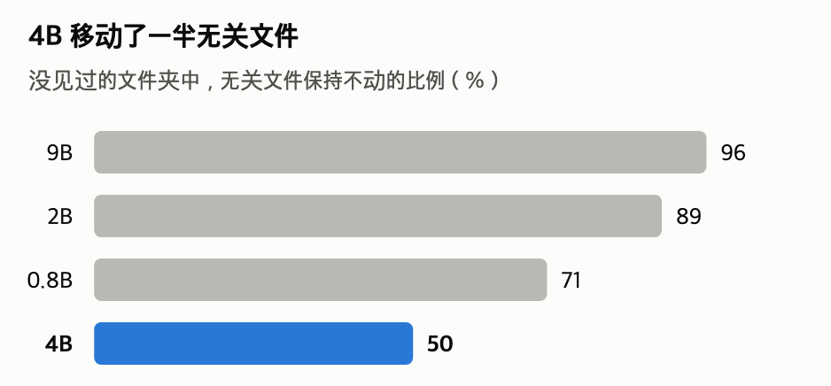

[English](README.md) · [한국어](README.ko.md) · [中文](README.zh-cn.md)

# file-sorting-qwen3.5

**小型 Qwen 能把文件夹分好类。按什么来分，它定不了。**

这是一个用你自己电脑上运行的 Qwen3.5 9B 把文件夹里的文件按项目分开的工具。由人给出项目名称和一行说明，在 20 个从没见过的合成文件夹中，有 19 个的计划只需稍作修改就能批准（在 RTX 4090 上测得，说明是看着正确答案写的最佳条件）。如果连清单也交给模型，9B（8 位）也只有 6 个（同样的 8 位模型给出清单时为 18 个）。

模型为每个文件选好去处，人批准这份计划后才移动。不删除文件，移动过的文件可以撤销。


在 16GB 的 Mac 上用 9B 4 位整理示例文件夹后又撤销。示例文件夹是修改工具时用过的一个开发用文件夹。移动的 14 个文件全部与正确答案一致。模型挑选的 3 分 13 秒按 30 倍速，其余按 3 倍速。

## 目录

- [模型](#模型)
- [快速开始](#快速开始)
- [摘要](#摘要)
- [可以借用的三种方法](#可以借用的三种方法)
- [1 测试方法](#1-测试方法)
- [2 我的设备能跑吗？](#2-我的设备能跑吗)
- [3 各功能的结果](#3-各功能的结果)
- [4 建议](#4-建议)
- [5 局限与没测的内容](#5-局限与没测的内容)
- [6 更小的模型](#6-更小的模型)
- [常见问题](#常见问题)
- [仓库结构](#仓库结构)
- [许可证](#许可证)

## 模型

- **模型**：把 [Qwen3.5](https://huggingface.co/collections/Qwen/qwen35) 9B 压缩到 4 位的 GGUF 文件（[unsloth/Qwen3.5-9B-GGUF](https://huggingface.co/unsloth/Qwen3.5-9B-GGUF) 的 `Qwen3.5-9B-Q4_K_M.gguf`，5.7GB）。不使用思考模式。
- **运行**：由 [model-compose](https://github.com/hanyeol/model-compose) 用 llama.cpp 启动。它是用一个配置文件把模型和网页一起启动的工具。
- **正文写的是 9B 的结果**。0.8B、2B、4B 和 2 位也用同样方式测过，集中放在[第 6 节](#6-更小的模型)。

## 快速开始

需要准备
- macOS 或 Linux，Python 3.12（用 `python3.12 --version` 检查，没有的话 `brew install python@3.12`）
- 至少 6.9GB 的空闲内存。请关掉不用的大型应用。交换空间（swap）占满时会慢好几倍（第 2 节）。
- macOS 上需要 Xcode Command Line Tools（`xcode-select --install`）。安装时会编译 llama-cpp-python。
- 带 NVIDIA GPU 的 Linux 需要 CUDA 工具包（`nvcc`），并用 `CMAKE_ARGS="-DGGML_CUDA=on" pip install -r requirements.txt` 安装。直接 `pip install` 会把 llama-cpp-python 编译成只用 CPU 的版本，慢很多。
- 第一次启动时会下载 5.7GB 的模型文件。

**1. 安装**

```bash
git clone https://github.com/MindrLabs/file-sorting-qwen3.5.git
cd file-sorting-qwen3.5
python3.12 -m venv .venv && source .venv/bin/activate
pip install -r requirements.txt   # 固定为 model-compose 0.4.120、llama-cpp-python 0.3.36、torch 2.14.1、huggingface_hub 2.2.0
cp .env.sample .env                # 实测过的设置：9B 4 位，上下文 8K。去掉这一行会加载 4B 8 位
```

**2. 用示例文件夹试试**

```bash
cp -R examples/sample-folder workspace    # 示例文件夹（顶层 19 个文件）
model-compose up
```

终端出现 `Uvicorn running on http://127.0.0.1:8081` 后，打开 http://localhost:8081 。上方的四个标签页是 `organize`、`draft-projects`、`organize-quick`、`undo`，打开的是第一个 `organize`。界面文字是英文。

1. 把下面三行粘贴到 `projects` 框里，按 **Run Workflow**。框空着的话模型会连清单一起写，那样结果差得多（3.1）。页面上的提示“Leave empty to let the model name them”说的就是这种情况。

   ```text
   gpu-bench: GPU benchmark runs: results, run and plot scripts.
   tax-2026: 2026 taxes: receipts, invoices, and withholding statements.
   wedding: Wedding planning: guest list, venue quotes, and invitations.
   ```

2. 在 16GB 的 Mac 上等 2–3 分钟，“Awaiting 1 answer”下方会出现计划。`plan` 里 `文件 => 文件夹` 连着写、没有换行。
3. **让 Answer 框保持空白，按 Resume** 就是批准。文件移动后，结果框一行一个列出来。不在计划里的文件留在原处。可以用 Finder 或 `ls -R workspace` 查看。

   

4. 要撤销，就在 `undo` 标签页按 **Run Workflow**。每按一次撤销一次整理。

要把示例文件夹恢复到初始状态，运行 `rm -rf workspace && cp -R examples/sample-folder workspace`。

> 第一个标签页对每个文件改变清单顺序问四次，只有三次以上答案一致时才移动（[方法 2](#2-改变顺序多问几次只有多数一致才移动)）。一个 40 个左右文件的文件夹，在 16GB 的 Mac 上中位数 7 分 38 秒，在 RTX 4090 上约 20 秒。如果页面一直显示 Running，就按 Cancel，关掉其他应用后再跑一次。

**3. 用在自己的文件夹上**

1. 关掉服务器（Ctrl+C），把 `.env` 里的 `ORGANIZE_ROOT` 改成要整理的文件夹的绝对路径，再重新启动。模型读不到也移不动这个文件夹之外的东西。

   ```bash
   ORGANIZE_ROOT=/Users/me/Downloads/sort-me    # 先从几十个文件的文件夹开始
   ```

2. 在 `projects` 框里每行写一个项目，格式是 `名称: 说明`。怎样写好一行，见[方法 1](#1-项目由人来定并附一行说明)。不知道写什么时，把 `draft-projects` 标签页的草稿改一改再用。草稿大多需要修改（[常见问题](#清单要人来写那还有什么意义)）。草稿标签页不移动文件。
3. 计划里错的行太多时，按 **Cancel**，什么都不会移动。改好说明再跑一次，比用 JSON 修改计划更容易。

整理的范围
- 只整理顶层的文件。子文件夹里的文件、隐藏文件和快捷方式（符号链接）都不动。
- 顶层子文件夹在 6 个以内时全部作为候选去处。多于 6 个时，只有在 `projects` 框里写了名称的文件夹才是候选。
- PDF、图片这类非文本文件，只看文件名来挑选。
- 每个文件单独问，所以时间随文件数成比例增长：在 Mac 上用 9B 问一次，100 个文件大约 5 分钟。没有测过几百个文件的文件夹。

<details>
<summary>修改或拒绝计划、快速标签页、投票记录、换成 2B、端口</summary>

- **修改后批准**：在 Answer 框里写以批准步骤的 `id` 为键的 JSON。例：`{"<id>": "a.txt => tax-2026\nb.txt => wedding"}`。换行写成 `\n`。
- **拒绝**：`{"<id>": "REJECT: 理由"}`
- **在 Answer 框里放了别的文字、页面不再前进时**，按 Cancel 再 Run 一次。
- **更快**：`organize-quick` 标签页只问一次，在 Mac 上大约 2 分钟。不过在真实下载文件夹上并不可用（3.4）。
- **文件为什么留在原处**：每个文件的四次回答按每个文件一行记在该文件夹的 `.organizer/votes/` 里。可以看出是答案不一致（项目名或 `none`），还是答案不在清单上（`null`，旁边记着模型的原始回答）。
- **已有的文件夹**：给它写的说明不会被使用。光看名称看不出内容的文件夹，最好先改名（没有测过）。
- **换成 2B**：把 `.env` 里的三行（`LLM_REPO`、`LLM_GGUF`、`LLM_REVISION`）改成 `.env.sample` 注释里写的 2B 值。`LLM_REVISION` 是测量时用的模型文件的提交。文件 1.3GB，内存 2GB，在 Mac 上每个文件夹 30 秒出头（问一次）。不过在没见过的文件夹中可用的不到一半，在 Mac 上测的 4 个开发用文件夹中只有 1 个可用（[第 6 节](#6-更小的模型)）。
- **分享重跑的结果时**：`python3 tools/env_report.py [模型.gguf]` 会写出版本和模型文件。
- **端口**：网页是 8081，API 是 8080。两者都按 model-compose 0.4.120 的默认值，只在本机（127.0.0.1）上开放。用 `.env` 里的 `SERVER_PORT`、`PORT` 修改。

</details>

## 摘要

从这里开始是测量结果。只想使用的话，读[可以借用的三种方法](#可以借用的三种方法)、[4 建议](#4-建议)和[常见问题](#常见问题)就够了。

- “可用文件夹”是指模型的第一份计划只需改每五行中不超过一行就能批准的文件夹。能否批准由持有答案表的评分程序（代理审阅者）判断（[第 1 节](#1-测试方法)）。
- “没见过的文件夹”（held-out）是 20 个合成文件夹，测量的一方没看过其内容，只在测量工具全部改完之后才使用。
- “成对 F1”（0–1）看同一项目的文件是否被分进了同一个文件夹。1 表示与正确答案的分组相同。
- 名称后没有量化标记的模型是 8 位（Q8_0）；4 位是 Q4_K_M 文件。在真实文件夹上测的 9B 都是 4 位。[ ] 是 Wilson 95% 区间。

1. **给出项目清单和说明时，9B 4 位在 19/20 个没见过的文件夹上可用（[76, 99]）**。让模型连清单也写时，9B 也只有 6/20。[3.1](#31-给出清单-vs-清单也交给模型)
2. **一行说明改变了结果**。在真实下载文件夹上，只给 9B 项目名称时成对 F1 是 0.32，给看过文件名后写的说明（细致型）时是 0.46。[方法 1](#1-项目由人来定并附一行说明)
3. **改变清单顺序问四次、只在多数一致时移动，错误的移动减少了**。在真实下载文件夹上，送进错误文件夹的文件从 21 个降到 6 个（一个文件夹、一次）。时间是 2.4–2.5 倍。[3.2](#32-问四次取多数)
4. **9B 4 位在 16GB 的 Mac 上最多用 6.9GB 运行**。每个文件夹问一次大约 2 分钟，问四次中位数 7 分 38 秒（不占用交换空间时）。[第 2 节](#2-我的设备能跑吗)
5. **9B 压缩到 4 位，结果与 8 位相同**。[3.5](#35-量化)
6. **没什么可整理的文件夹不能交给它**。在所有文件都应留在原处的桌面副本（30 个文件）上，连清单也交给模型时，9B 4 位也想移动 25 个。[3.3](#33-挑选与保持不动)
7. **不用 AI 的对照基线在合成文件夹上也通过了（TF-IDF 16/20）**。与 9B 4 位的差异无法断言。在真实下载文件夹上不可用。[常见问题](#像-tf-idf-这样的词语比对不就够了吗)
8. **测量期间没有丢过文件**。4,983 次测量运行中，整理后立刻撤销，所有文件都和原来一样。[方法 3](#3-预览与撤销)

**读这些数字时**

- 19 个是最佳条件下的数字。项目说明是看着正确答案写的，能否批准由持有答案表的评分程序判断。换成人来审阅，可能会比这更低（[1.1](#11-代理审阅者可信吗)）。推荐设置（9B 4 位、问四次）是在看到其他设置的结果之后才加上的条件（第 5 节）。
- 真实文件夹只有两个，每种设置只测一次。在真实下载文件夹上，只有细致型说明加上问四次时才可用（[3.4](#34-真实下载文件夹)）。
- 适合已经清楚有哪些项目、有几十个文件的文件夹。不适合还不知道按什么分、或几乎没什么可整理的文件夹（[常见问题](#清单要人来写那还有什么意义)）。

表 1：推荐设置（给出名称和说明；真实下载一栏用细致型说明）

| 设置 | 模型文件 | 内存（16GB Mac） | Mac，一个文件夹 | RTX 4090，一个文件夹 | 没见过的文件夹中可用的 | 真实下载（测一次） |
|---|---|---|---|---|---|---|
| **9B Q4_K_M，问四次（第一个标签页）** | 5.7GB | 6.9GB | 7 分 38 秒 | 约 20 秒 | **19/20 = 95% [76, 99]** | 可用（需改的行 9.4%） |
| 9B Q4_K_M，问一次 | 5.7GB | 6.5GB | 约 2 分钟 | 约 8 秒 | 19/20 = 95% [76, 99] | 不可用（需改的行 32.8%） |

- 一个文件夹约 40 个文件。时间是从请求到拿到回答的中位数，不含第一次加载模型的时间。内存是各文件夹中的最大值。
- Mac 上两行测量期间交换空间都没有增长（问四次前后都是 0）。交换空间占满时会慢得多（第 2 节）。
- 没见过的文件夹用 65K 上下文测，时间和内存用 8K 测。两种上下文的第一份计划只在开发用文件夹的问一次上比较过，结果相同。
- 内存按 1GB = 1024MB 计。2B 4 位见[第 6 节](#6-更小的模型)。

## 可以借用的三种方法

这是本工具用到的三种方法。第一种经测量确认了效果。第二种减少了错误的移动，但移动的文件也减少了，9B 的可用文件夹变多只在真实文件夹上出现过一次。第三种是安全措施。其他分类工作也可以试用同样的结构，但本仓库只测了文件。


图 1：文件夹整理的工作顺序。方框上方的名称是负责该步骤的一方。

### 1. 项目由人来定，并附一行说明

在没见过的合成文件夹上，9B 很擅长判断“这个文件属不属于这个项目”（送进指定文件夹的正确比例 95%）。但它找不出“这个文件夹里有哪些项目”（3.1）。所以项目清单由人给出。不要只给名称，要附一行说明。

| 不太好的一行 | 好的一行 |
|---|---|
| `garden` | `garden: 种子订单、花坛布置图、番茄苗` |
| `tax` | `tax-2026: 2026 taxes: receipts, invoices, and withholding statements.` |
| `misc: 其他文件` | 不要写。哪儿都不合适的文件，即使不在清单里也会留在原处 |

- 说明里写那个项目的文件中真正出现的词：人名、地点、文件种类等。
- 已有的文件夹就照原名写。用新名字的话，同一个项目会被分到两个文件夹。给已有文件夹写的说明不会被使用。
- 在真实下载文件夹上，9B 拿到看过文件名后写的说明（“细致型”）时，比拿到只看项目名称写的 3–6 个词的说明（“日常型”）时多答对 13 个文件（63 个中 42 个对 29 个）。日常型和只给名称差不多（成对 F1 0.31 对 0.32）。

### 2. 改变顺序多问几次，只有多数一致才移动

对每个文件，只改变清单顺序，把同一个问题问四次。四次中有三次以上选了同一个项目就移动，否则留在原处。候选少于四个时，问的次数等于候选数，全部一致才移动。“三次以上”这个门槛不是根据数据调出来的数字。规则的其余部分是在开发用文件夹上做出来的（第 5 节）。

多问几次取多数（[self-consistency](https://arxiv.org/abs/2203.11171)），以及改变清单顺序多问几次（[permutation self-consistency](https://arxiv.org/abs/2310.07712)），都是已有的方法。本工具同时使用两者，没有形成多数时不移动。


图 2：问四次把没把握的 7 个文件留在原处。一个文件夹、一次的结果。在 20 个没见过的文件夹上，需改的行从 8.3% 降到 4.3%，可用比例不变（表 4）。

- 问的次数是四倍，所以时间是 2.4–2.5 倍（以 4090 总计为准）。
- 没把握的文件不移动，所以移动的文件也会减少。在真实下载文件夹上，9B 把 63 个有答案的文件中的 7 个留在了原处。所以只看需改的行比例，效果会显得比实际大（3.4）。
- 在更小的模型上效果不同（[第 6 节](#6-更小的模型)）。

### 3. 预览与撤销

- 模型不能直接移动文件。代码把模型选的答案汇总成计划，再按人批准的计划由代码移动。
- 不删除也不覆盖文件。目标位置已有同名文件时，跳过那一行。每次移动都留下记录，用 `undo` 从最近一次整理开始依次撤销。4,983 次测量运行在撤销后，所有文件都和原来一样。这些运行反复使用同一批文件夹，所以不是相互独立的试验。权限问题、云同步文件夹、整理后修改文件再撤销的情况没有测试。
- 仅靠批准画面挡不住所有错行。作者亲自审阅计划时，错行中约六分之一在人看来也是对的（样本小，[1.1](#11-代理审阅者可信吗)）。

## 1 测试方法

确认的方法
- 所有表格都可以用 `python3 scripts/report_tables.py` 连同区间一起重新算出。
- 哪个结果文件支撑哪张表，见 [results/README.md](results/README.md)。
- 重建文件夹再测、用第一份计划的哈希确认逐字节相同的方法，见 [measure/README.md](measure/README.md)。
- 登记的预测和修改记录，见 [docs/preregistration.zh-cn.md](docs/preregistration.zh-cn.md)。

本报告用到的说法如下。

- **可用文件夹（可用运行）**：第一份计划稍作修改就能批准。四条必须全部满足：需改的行不超过 20%，有答案的文件移动了 60% 以上，已整理好的文件夹不动，结束时停下。能否批准由代理审阅者判断。只要移动有答案文件中的 60% 以上即可，所以可用文件夹里也可能留有没移动的文件。
- **通过**：20 个没见过的文件夹中至少 15 个（75%）可用。这是可用比例的 95% 置信区间下限达到 0.5 的线，超过它就可以说可用比例超过一半。9B 4 位是 20 个中的 19 个，下限为 76%。可用比例是按阈值切出来的，成对 F1 的小差异也可能让它大幅变动。
- **需改的行比例**：代理审阅者在第一份计划中修改或删除的行 ÷ 计划的行数。放在两个项目中任何一个都说得通的模糊文件不计入评分（分子分母都不算）。写到小数点后一位。另外，每个项目以其文件去得最多的文件夹作为该项目的文件夹。所以把整个项目集中到另一个名字的文件夹里，也算对。
- **成对 F1（pairwise F1，0–1）**：按“同一项目的两个文件是否去了同一个文件夹”成对计数得出的分数。1 表示与正确答案的分组相同。只有一个文件的项目没有配对，几乎不会被计入。模型之间比较时，在相同文件夹上求差，再对文件夹重抽样得到 95% 区间。区间不含 0 写“有差异”；含 0 且整个区间在 ±0.05 以内写“相同”；其他写“无法判断”。
- **代理审阅者**：持有答案表的程序（oracle）。它代替人修改第一份计划中的错行并批准。不修改模糊文件。

没见过的文件夹和开发用文件夹的准确率在 RTX 4090 上测，真实文件夹在 16GB 的 Mac 上测。文件夹、说明、引擎、对照基线、流程的详细条件折叠在下面。

<details>
<summary>全部测试条件</summary>

| 项目 | 内容 |
|---|---|
| 没见过的文件夹 | 20 个判定用合成文件夹。测量的一方没看过文件夹内容。在固定流程后每种设置各用一次；9B 4 位的条件和问四次的条件是在看到其他条件的结果之后加的（第 5 节）。每个文件夹有 39–48 个文件、4–6 个项目 |
| 开发用文件夹 | 修改工具时用的 12 个合成文件夹，做法与没见过的文件夹相同。37% 的文件不属于任何项目，应留在原处。快速开始的示例文件夹（`examples/sample-folder`）是在这之前用过的一个开发用文件夹 |
| 合成文件夹的做法 | 项目、文件名和线索句的位置与测量的一方分开设计，文件由固定种子的生成器写出。文本文件用与项目无关的段落填充，把线索句放在开头 300 字以内、300–2,000 字之间、2KB 之后三处之一。非文本文件是真实格式的文件头加随机字节，读不出内容 |
| 项目说明 | 每个文件夹看着正确答案以及文件名和文件开头写。格式是“做什么：放进去的 3–4 样东西”，不超过 90 字，不许照抄文件名。已有文件夹不写说明。相当于熟悉自己项目的人写一次的最佳条件 |
| 真实文件夹 | 从作者的下载文件夹复制最近 70 个文件的文件夹（19 个项目，答案由作者确定），以及桌面副本（30 个文件，全部应留在原处）。下载文件夹的两套说明（细致型、日常型）也是看着答案表写的 |
| 设备 | 没见过的文件夹和开发用文件夹的准确度在 RTX 4090（24GB）上测，真实文件夹在 16GB Mac（Apple M2）上测。内存和时间两边都测了。9B 4 位的开发用文件夹又在 DGX Spark（GB10）上跑了一遍 |
| 引擎与设置 | llama.cpp（llama-cpp-python）、model-compose。不使用思考模式。上下文：没见过的文件夹为 65K，在 Mac 上测的推荐设置为 8K。测量用的是会把 presence_penalty、min_p 传给 llama.cpp 的 model-compose 构建（基于 0.4.120）。PyPI 0.4.120 不传这两个值。在 Mac 上测的 4 个开发用文件夹（2B、9B 4 位，问一次）中，8 份第一份计划在两个构建下相同（这项比较只在工作记录里，不在 results/ 中） |
| 重复 | 每个文件夹一次。在同一台设备上用同样设置重跑，第一份计划逐字节相同。Mac 和 4090 在同样的模型文件和设置值下第一份计划也可能不同。构建也不同（第 5 节） |
| 模型看到的内容 | 每个文件的文件名，文本文件再加开头 300 字，以及项目清单。即使清单由人给出，模型在项目步骤也会看一次文件夹的文件列表，每个文件截到 160 字 |
| 对照基线 | 不用 AI 的 TF-IDF 词语比对，以及 0.6B 嵌入（Qwen3-Embedding-0.6B）。它们拿到与模型相同的清单，读取每个文件的名称和文本文件开头 2KB（比模型看得多）。每个文件送到最相似的项目，相似度低于阈值就留在原处。阈值取在开发用文件夹上成对 F1 最高的值，真实文件夹上也原样使用 |
| 流程 | **分步流程**（本工具）：代码决定顺序，模型只为每个文件做选择。**工具代理**：模型自己选工具（查看文件夹、预览、读取、建议分组、确定清单、分配、提交）推进。在 3.6 和第 6 节比较 |

</details>

### 1.1 代理审阅者可信吗？

作者在不看代理审阅者判断的情况下亲手修改了部分计划，并作了比较。样本小（第 5 节）。

- 代理审阅者改过的行中，有 83% 人也改了。其余约六分之一明明是错行，在人看来却是对的，所以没改。
- 人反而删掉了更多只看名称没把握的行。所以“需改的行 20%”这条标准比谨慎的人宽松。真人审阅时，可用文件夹可能比本报告的数字少。

## 2 我的设备能跑吗？

这个工具向模型问很多短问题，不需要长上下文。把上下文从 65,536 缩到 8,192、用问一次重跑开发用文件夹，9B 4 位的第一份计划逐字节相同（2B、4B 也相同；问四次没有比较）。内存大幅减少。

表 2：9B Q4_K_M 的内存和时间（内存为各文件夹中的最大值，时间为中位数，1GB = 1024MB）

| | RTX 4090 | 16GB Mac | DGX Spark |
|---|---|---|---|
| 内存，上下文 65K | 9.5GB | 没测 | 没测 |
| 内存，上下文 8K | 6.0GB | 6.5GB（问四次 6.9GB） | 5.8GB |
| 一个文件夹，问一次 | 8 秒（8–10 秒） | 2 分钟（1 分 31 秒至 2 分 49 秒） | 14 秒（12–14 秒） |
| 一个文件夹，问四次 | 20 秒（18–24 秒） | 7 分 38 秒（5 分 02 秒至 10 分 46 秒） | 39 秒（32–44 秒） |

- 没测的设备：M1、M3、M4 Mac，8GB 设备，Windows，手机。内存为 16GB 的其他 Apple Silicon Mac 应该也装得下，但速度可能不同。

<details>
<summary>交换空间、DGX Spark、27B 等细节</summary>

- Mac 上的问一次，测量前后交换空间都是 3.9GB，测量期间没有增长。
- Mac 上问四次是关掉其他应用后测的，测量前后交换空间都是 0。在交换空间从 7.6GB 涨到 13.3GB 的状态下测时，完成的 3 个文件夹中位数是 10 分 19 秒，有一个文件夹因为工具命令超出时间限制而没有完成。
- 测真实下载文件夹（70 个文件）时，交换空间占用 8GB 左右；9B 问一次用了 10 分 30 秒，问四次用了 23 分 36 秒。
- Mac 和 4090 在同样的模型文件和设置值下第一份计划可能不同（第 5 节）。在 Mac 上测的 4 个开发用文件夹中，9B 4 位问一次 4 个全部可用，问四次 4 个也全部可用。
- 在 DGX Spark（NVIDIA GB10）上，用 PyPI 的 model-compose 0.4.120 和用 CUDA 编译的 llama-cpp-python 跑了全部 12 个开发用文件夹。问四次 12 个文件夹全部可用，问一次 12 个中有 11 个可用（dev-07 要改的行占 21.4%，超过 20% 的标准；在 4090 上是 18.5%）。第一份计划与 4090 相同的文件夹，问四次是 12 个中的 7 个，问一次是 12 个中的 6 个。这次重测用的工具看不到停止检查，所以这里的“可用”少了这一项检查。PyPI 0.4.120 不传 `presence_penalty` 和 `min_p`（`.env.sample`）。内存是用 `nvidia-smi` 测的服务器 GPU 内存。测量期间另一位用户的服务占着约 56GB 共享内存，测量前后 GPU 使用率都是 0%。在示例文件夹（顶层 19 个文件）上，问一次用了 10 秒，问四次用了 20 秒。
- 27B 4 位（16.7GB）用工具代理流程和 65K 上下文在 24GB GPU 上运行，第一次运行中因 CUDA 错误停止。没有另外确认是否内存不足，也按登记没有缩小上下文重测。
- 更小模型的内存和时间见[第 6 节](#6-更小的模型)。

</details>

## 3 各功能的结果

### 3.1 给出清单 vs 清单也交给模型

给出清单和说明时，9B 4 位和 8 位都通过了（19 个、18 个），不用 AI 的 TF-IDF 也通过了（16 个）。让模型连清单也写时，9B 也只有 6 个。


图 3：从表 3 和表 8 中选出。通过线是 20 个中 15 个。

<details>
<summary>表 3 与统计</summary>

表 3：20 个没见过的文件夹中可用的文件夹（分步流程，上下文 65K）

| 设置 | 可用的文件夹 |
|---|---|
| 9B 4 位，名称和说明 | **19/20 = 95% [76, 99]（通过）** |
| 9B 4 位，名称和说明，问四次 | **19/20 = 95% [76, 99]（通过）** |
| 9B 8 位，名称和说明 | **18/20 = 90% [70, 97]（通过）** |
| TF-IDF（无 AI），名称和说明 | **16/20 = 80% [58, 92]（通过）** |
| 9B 8 位，清单也交给模型 | 6/20 = 30% [15, 52] |

- 通过线是区间下限 50%（20 个中 15 个以上）。9B 8 位和 4 位只差一个文件夹，说不出谁更好。
- 给出清单后，9B 8 位从 6 个增加到 18 个（McNemar，Holm p 0.004）。成对 F1 也有差异：+0.135 [+0.077, +0.203]。
- 9B 4 位与 TF-IDF 的差异无法断言（19 对 16，Holm p 1.0）。成对 F1 之差 −0.007 [−0.090, +0.082]，无法判断。
- 工具代理写的清单（开发用文件夹）中常见的错误，是建“其他”“misc”这类杂物文件夹，以及给已有文件夹换个名字再建一个，把一个项目分到两个文件夹。
- 包括 0.8B、2B、4B 和 0.6B 嵌入的完整表格见[第 6 节](#6-更小的模型)。

</details>

### 3.2 问四次取多数

问四次让真实下载文件夹变得可用（需改的行 32.8% → 9.4%）。在没见过的文件夹上，需改的行从 8.3% 降到 4.3%，可用文件夹仍是 19 个。

<details>
<summary>表 4 与统计</summary>

表 4：问一次 → 问四次（9B 4 位，名称和说明；没见过的文件夹为上下文 65K，其余为 8K）

| 文件夹 | 可用的文件夹 | 需改的行比例 | 应留原处却被移动的文件数 | 成对 F1 |
|---|---|---|---|---|
| 没见过的文件夹 | 19/20 → 19/20 | 8.3% → 4.3% | 15 → 6 | 0.63 → 0.64 |
| 开发用文件夹 | 12/12 → 12/12 | 6.3% → 4.1% | 11 → 7 | 0.67 → 0.69 |
| 真实下载 | 否 → **是** | 32.8% → 9.4% | 4 → 3 | 0.46 → 0.84 |

- 在没见过的文件夹上，两种方式的差异无法断言（Holm p 1.0）。成对 F1 之差为 +0.003 [−0.010, +0.017]，相同。
- 不同种类文件夹之间不能比较成对 F1 的大小。合成文件夹和真实文件夹的项目数量和规模不同。
- 在没见过的文件夹上，9B 移动的配对中正确配对的比例（成对精确率）从 0.81 升到 0.89，有答案文件中被移动的比例从 0.78 降到 0.74。
- 2B、4B 的结果见[第 6 节](#6-更小的模型)。

</details>

### 3.3 挑选与保持不动

在没见过的文件夹上，9B 把 95% 以上的文件送进了正确的指定文件夹，也把 95% 以上的无关文件留在了原处。

没什么可整理的文件夹更难。在装有 30 个全部应留在原处的文件的真实桌面副本上，连清单也交给模型时，9B 4 位也想移动 25 个。没有测由人给出清单的条件。更小的模型在这个文件夹上几乎想移动所有文件（[第 6 节](#6-更小的模型)）。

<details>
<summary>表 5</summary>

表 5：20 个没见过的文件夹的平均值（给出名称和说明）

| 模型 | 送进指定文件夹的正确比例 | 无关文件保持不动的比例 |
|---|---|---|
| 9B | 95% [93, 97] | 96% [92, 98] |
| 9B 4 位 | 96% [93, 98] | 95% [92, 98] |

[ ] 是对文件夹重抽样得到的 95% 区间。9B 很会挑选指定的文件夹，也把无关文件几乎都留在了原处。

</details>

### 3.4 真实下载文件夹

项目多达 19 个，其中一半以上只有 1–2 个文件，很多项目光看名称看不出是什么。比 4–6 个项目的合成文件夹难得多。只有一个文件的项目几乎不会计入成对 F1。

只有细致型说明加上问四次的条件可用（需改的行 9.4%）。对照基线（TF-IDF、嵌入）在所有条件下都不可用。


图 4：与表 6 同一个文件夹，问一次。细致型是看过文件名后写的说明，日常型是只看项目名称写的简短说明。

<details>
<summary>表 6、表 7 与计数方法</summary>

表 6：真实下载文件夹的第一份计划（Mac，9B 4 位，上下文 8K，有答案的文件 63 个）

| 设置 | 正确文件夹 | 错误文件夹 | 没移动 | 成对 F1 | 需改的行比例 | 可用吗 | 需要人处理的文件 |
|---|---|---|---|---|---|---|---|
| 细致型说明，问四次 | 50 | 6 | 7 | 0.84 | 9.4% | **是** | 16 |
| 细致型说明 | 42 | 21 | 0 | 0.46 | 32.8% | 否 | 25 |
| 日常型说明 | 29 | 27 | 7 | 0.31 | 38.9% | 否 | 37 |

- 细致型是看过文件名、写进文件种类的说明；日常型是只看项目名称写的 3–6 个词的说明。两者都是看着答案表写的。
- 正确文件夹、错误文件夹和没移动，是对 63 个有答案文件的计数。需改的行比例按代理审阅者计算，计法不同：模糊文件（这个文件夹里有 6 个）不计入，每个项目以其文件去得最多的文件夹作为该项目的文件夹。把整个项目集中到另一个名字的文件夹的行算作正确，所以比按错误文件夹数算出的比例低。
- 需要人处理的文件 = 错误文件夹 + 错移的应留文件 + 没移动的文件。
- 问一次用测量构建测，问四次用 PyPI 0.4.120 测。PyPI 版不把 presence_penalty、min_p 传给 llama.cpp，所以两次运行的采样设置略有不同（第 1 节）。

表 7：同一文件夹、与模型相同的清单下，9B 4 位与对照基线（成对 F1，括号内为需改的行比例）

| | 只给名称 | 细致型说明 | 日常型说明 |
|---|---|---|---|
| 9B 4 位，问四次 | 没测 | **0.84（9.4%）** | 没测 |
| 9B 4 位，问一次 | 0.32（35.2%） | 0.46（32.8%） | 0.31（38.9%） |
| 0.6B 嵌入 | 0.49（35.9%） | 0.40（32.7%） | 0.36（38.5%） |
| TF-IDF | 0.14（24.0%） | 0.23（22.6%） | 0.14（26.9%） |

- 一个文件夹测一次，所以没有区间。下面的“更高”只是把数字并排放在一起，不是判定过的差异。
- 对照基线在所有条件下都不可用。TF-IDF 需改的行最少，但只移动了有答案文件中的 37–47%，没达到 60% 的标准。嵌入的需改的行为 32.7–38.5%。
- 只给名称时，0.6B 嵌入（0.49）高于 9B 问一次（0.32）。不过它移动了所有有答案的文件，需改的行为 35.9%。
- 给出细致型说明后，9B 从 0.32 升到 0.46。对照基线中 TF-IDF 从 0.14 升到 0.23，嵌入从 0.49 降到 0.40。日常型说明下，嵌入（0.36）也高于 9B 问一次（0.31）。
- 对照基线在没把握时保留不动的手段（相当于问四次的作用）只有一个阈值，而这个阈值是在合成的开发用文件夹上定的。
- 2B 在真实下载文件夹上的结果见[第 6 节](#6-更小的模型)。

</details>

### 3.5 量化

9B 从 8 位压缩到 4 位，成对 F1 之差为 +0.003 [−0.011, +0.016]，相同（20 个没见过的文件夹，按文件夹配对）。可用文件夹 18 个和 19 个，也说不出谁更好。2B、4B 和 2 位见[第 6 节](#6-更小的模型)。

### 3.6 流程：代码定顺序 vs 模型选工具

在连清单也交给模型的条件下比较了两种流程。对 9B，由代码决定顺序的分步流程比工具代理的成对 F1 高 +0.09 [+0.01, +0.18]。不过在这个条件下，两种流程都远没达到通过（工具代理 1/20 = 5%，分步流程 6/20 = 30%）。2B、4B 见[第 6 节](#6-更小的模型)。

## 4 建议

- **项目名称和一行说明自己写**。说明里写文件中真正出现的词。
- **16GB 笔记本用 9B Q4_K_M、上下文 8K、第一个标签页（问四次）**。关掉其他应用再运行。不占用交换空间时一个文件夹中位数 7 分 38 秒，交换空间占满时有文件夹没有完成。问一次更快，但在真实下载文件夹上不可用。把问四次设为默认，依据是这个真实文件夹上的一次结果。在没见过的文件夹上，可用比例不变。
- **9B 用 4 位就够了**。更轻的模型（如 2B）请先看[第 6 节](#6-更小的模型)再选。2B 4 位只在 45% 的没见过的文件夹上可用。
- **不要只信批准画面，要用撤销**。部分错行在人看来也是对的。
- **几乎没什么可整理的文件夹（如桌面）不要交给它**。在连清单也交给模型的条件下，9B 4 位也想移动大部分文件。

## 5 局限与没测的内容

- **判定用文件夹是合成的**。项目、文件名和线索位置与测量分开设计，但文件内容和开发用文件夹出自同一个生成器。所以它能回答“没见过的设计”，回答不了“没见过的那类文件夹”。在合成文件夹上，不用 AI 的 TF-IDF 也通过了。
- **项目说明是看着答案写的**。在没见过的文件夹上这是最佳条件。在真实下载文件夹上，也没有测文件夹主人不看答案表写的说明。
- **没见过的文件夹用了不止一次**。固定流程后每种设置各用一次，但 9B 4 位的条件是在看到 9B 8 位的结果（18 个）之后加的，问四次的条件是在看到 2B 4 位的结果（9 个）之后加的。问四次的规则只用开发用文件夹定，在没见过的文件夹上用 9B 测了一次。所以这两个条件并不完全是“没见过”的。
- **真实文件夹只有两个，每种设置跑一次**。问四次在真实下载文件夹上变得可用（错误移动 21 → 6），是一个文件夹、一次的个例，不是统计结论。日常型说明加问四次的条件，以及在桌面上由人给出清单的条件，都没有测。
### 其他局限

- **没有涵盖重复运行和清单顺序带来的波动**。在同一台设备上重跑会得到同样的第一份计划，所以每个文件夹只跑一次，没有改变采样种子或清单顺序重跑。正如问四次的效果所示，问一次的回答可能随清单顺序而变。
- **Mac 和 4090 的结果可能不同**。在同样模型文件和设置值的 4 个开发用文件夹上，9B 问一次的第一份计划有 2 个文件夹不同（问四次：1 个文件夹不同）。两台设备的 llama.cpp 和 model-compose 构建不同，问四次连配置文件的版本也不同。所以无法分清差异来自设备还是构建。所以不能说在 4090 上测的比例在 Mac 上也照样成立。在 Mac 上，问一次 4 个文件夹全部可用，问四次 4 个也全部可用。在构建又不相同的 DGX Spark 上，第一份计划与 4090 相同的开发用文件夹，问四次是 12 个中的 7 个，问一次是 12 个中的 6 个。
- **样本量**。没见过的文件夹是 20 个文件夹各一次（9B 4 位 19 个，9B 18 个，TF-IDF 16 个，模型清单 9B 6 个）。问四次的开发用比较是 12 个文件夹各一次（9B 12 → 12 个）。Mac 的时间各用 4 个开发用文件夹。DGX Spark 各用 12 个开发用文件夹。
- **人工核对只有作者一个人、8 个计划（166 行）**。代理审阅者改过的 59 行中，人也改了 49 行；错的 59 行中有 10 行在人看来是对的。没有统计按人的标准可用文件夹会少几个。
- **清单草稿只在真实下载文件夹上测过一次**。9B 的草稿在 19 个项目中大约 4 个可以直接用，有 3 行把不同的项目混在一起，有 8 个漏掉了。草稿设定为给出 2–8 个项目，所以在项目多的文件夹里只能抓到一部分。
- **对照基线的保留手段只有一个阈值**。在合成的开发用文件夹上定的阈值，原样用在真实文件夹上。没有测装上相当于问四次的保留手段的对照基线，也没有测用嵌入分组、只让模型起名的方式。
- **规模与时间**。没有测几百个文件以上的文件夹，也没有与人手动整理所用的时间作比较。对照基线（TF-IDF、嵌入）的时间和内存也没有测。
- **没有单独统计非文本文件**。PDF、图片这类只看文件名挑选的文件，其准确度没有单独拆分。
- **正确答案的分组只有一种**。模型的分法即使和正确答案不同但说得通，也算错。没有测上限，即让人不看答案表做出清单，再用同样方式评分。
- **只测了 Qwen3.5 一个系列，且只在不使用思考模式时测**。没有与其他系列比较。
- **版本**。model-compose 或 llama.cpp 版本变了，同样的输入也可能得到不同的输出。与测量构建不同，PyPI 0.4.120 不传 presence_penalty、min_p（在 Mac 上测的 4 个开发用文件夹中，2B、9B 4 位的 8 份第一份计划在两个构建下相同。这项比较只在工作记录里，不在 results/ 中）。也没有单独看文件名语言（韩语、英语）带来的差异。
- **训练（微调）不在范围内**。问的是下载后直接使用的模型能做到什么程度。

<details>
<summary>看到结果之前写下的预测与结果</summary>

| 预测 | 结果 |
|---|---|
| 清单也交给模型时全部不通过，9B 最高 | 对一半：全部不通过，但在工具代理中 4B 4 位（2 个）多于 9B（1 个） |
| 给出名称和说明时 2B 不通过（20 个中 8–14 个） | 对（11 个） |
| 给出名称和说明时 9B 在边界上 | 错：以 18 个通过 |
| 2B 不太会把无关文件留在原处 | 错：留下了 89% |
| 对照基线（TF-IDF、0.6B 嵌入）不通过，成对 F1 也低于 2B | TF-IDF 两条都错（以 16 个通过；成对 F1 高于 2B）。嵌入两条都对（6 个；成对 F1 低于 2B） |
| 工具代理中 4B 4 位与 8 位无法判断 | 对（−0.013，无法判断） |
| 工具代理中 4B 2 位低于 8 位 | 对（−0.24） |
| 分步流程中 4B 2 位与 8 位无法判断 | 错：下降了 0.05 |
| 问四次能让 2B 的可用文件夹增加 | 错：错误移动减少了，但移动的文件也减少了，所以不变 |
| 问四次时 9B 保持现有水平 | 对 |

关于 9B 4 位的结果、上下文 8K、Mac 内存和时间的预测，是和结果一起记录的，不能算作结果之前的预测，所以没有列入。登记时间和修改记录见 [docs/preregistration.zh-cn.md](docs/preregistration.zh-cn.md)。

</details>

## 6 更小的模型

0.8B、2B、4B 和 2 位也和 9B 用同样的文件夹、同样的流程测过。这些比较做过预注册，所以没有删掉，而是集中放在本节。全部数字都可以用 [results/](results/README.md) 和 `python3 scripts/report_tables.py` 重新算出。

- **给出清单的效果在所有尺寸上都有。但能稳定给出可用计划的只有 9B**。连清单也交给模型时，0.8B 0%，2B、4B 5%。在开发用文件夹上另外问过的结果显示，从 4B 起能找出多个文件共有的项目（0.8B、2B 找不出）。
- **不是按尺寸排序的**。给出清单时 2B 55%，4B 5%。0.8B 即使给出清单也只有 10%。
- **4B 低于 2B 的原因候选，是它连无关文件也移动**。4B 只把 50% 的无关文件留在原处（2B 89%，9B 96%）。在桌面副本上，4B 4 位也想移动全部 30 个文件。这个解读只看了相关性，所以不断言是原因。没有和其他系列比较，所以也分不清这是 4B 本身的性质，还是和这个流程不合。
- **量化**：9B、4B 在 4 位下不变；2B 4 位和 4B 2 位下降了。

表 8：20 个没见过的文件夹中可用的文件夹，所有尺寸（分步流程，上下文 65K）

| 模型 | 清单也交给模型 | 只给名称 | 给出名称和说明 |
|---|---|---|---|
| 0.8B | 0/20 = 0% [0, 16] | — | 2/20 = 10% [3, 30] |
| 2B | 1/20 = 5% [1, 24] | 3/20 = 15% [5, 36] | 11/20 = 55% [34, 74] |
| 4B | 1/20 = 5% [1, 24] | 0/20 = 0% [0, 16] | 1/20 = 5% [1, 24] |
| 9B | 6/20 = 30% [15, 52] | — | 18/20 = 90% [70, 97]（通过） |
| 2B 4 位 | 0/20 = 0% [0, 16] | — | 9/20 = 45% [26, 66] |
| 4B 4 位 | 1/20 = 5% [1, 24] | — | 1/20 = 5% [1, 24] |
| 4B 2 位 | 0/20 = 0% [0, 16] | — | 2/20 = 10% [3, 30] |
| 9B 4 位 | — | — | 19/20 = 95% [76, 99]（通过） |
| TF-IDF（无 AI） | 不适用 | 10/20 = 50% [30, 70] | 16/20 = 80% [58, 92]（通过） |
| 0.6B 嵌入 | 不适用 | 9/20 = 45% [26, 66] | 6/20 = 30% [15, 52] |

- “—”是没测的格子。给出清单后，成对 F1 在所有尺寸上都上升了（0.8B +0.13，2B +0.16，4B +0.10，2B 4 位 +0.15，4B 4 位 +0.11，4B 2 位 +0.07，都有差异）。4B 的配对变好了，可用文件夹却没变。
- 2B 只给名称时 3 个，加上说明后增加到 11 个（McNemar p 0.008）。给出说明后 TF-IDF 上升，0.6B 嵌入反而下降。原因没有另外查。
- 按成对 F1，TF-IDF 高于 2B（−0.13）和 4B（−0.21），两者都有差异。



图 5：表 9 中的 8 位各行。

<details>
<summary>表 9：挑选与保持不动，所有尺寸</summary>

表 9：挑选与保持不动，所有尺寸（20 个没见过的文件夹的平均值，给出名称和说明）

| 模型 | 送进指定文件夹的正确比例 | 无关文件保持不动的比例 |
|---|---|---|
| 0.8B | 82% [77, 86] | 71% [62, 79] |
| 2B | 92% [88, 95] | 89% [83, 94] |
| 4B | 86% [82, 89] | **50% [44, 57]** |
| 9B | 95% [93, 97] | 96% [92, 98] |
| 2B 4 位 | 91% [87, 94] | 81% [74, 88] |
| 9B 4 位 | 96% [93, 98] | 95% [92, 98] |

4B 在挑选上也比 2B 略低，但两者都超过了事先定的标准（区间下限 80%），拉开差距的是保持不动。0.8B 连挑选都没达到标准。在桌面副本（30 个全部应留在原处的文件）上，第一份计划想移动的文件数为 2B 29 个、4B 4 位 30 个、9B 4 位 25 个（2B、4B 为上下文 65K，9B 为 8K）。

</details>

<details>
<summary>阶梯：每一级单独判定</summary>

- 每一级单独判定通过与否。前一级没过，下一级照样计数，所以并不是按顺序往上爬的阶梯。
- 各级条件：1 至少调用过一次工具。2 给出了计划，且没有读不懂的行。3 能从名称判断的文件中，移动的全部去了正确文件夹，且移动了 60% 以上。4 同样的条件，换成要打开才知道的文件。5 没有移动任何没有答案的文件或已经整理好的文件。7 最后一次移动文件之后，工具调用不超过两次。第 6 级（采纳拒绝）只在计划被拒绝时测，所以没有列出。
- 第 3、4、5 级错一个就算失败，很严格。可用的文件夹允许最多 20% 的行需要修改，所以不必全部通过。
- 第 4 级在所有行都是 0–1 个。分步流程中模型只看文本文件的前 300 个字符，而线索句常常在更后面（在开发用文件夹中，要打开才知道的文件里，线索在前 300 个字符内的占 36%）。9B 4 位没过第 4 级，仍有 19 个可用。
- 各设置之间的差距出现在第 3 级和第 5 级。分步流程中第 1、2、7 级全都是 20 个。只有由模型决定何时结束的工具智能体在第 7 级没过 11 个。4B 第 3 级过了 10 个，第 5 级一个也没过（图 5）。
- TF-IDF 不是会写计划的模型，所以没有第 1–4 级和第 7 级（第 5 级 14 个，可用的文件夹 16 个）。

所有设置的各级通过数（20 个没见过的文件夹）

| 设置 | 1 调用工具 | 2 计划格式 | 3 按名称归类 | 4 打开后归类 | 5 不动无关文件 | 7 停止 | 可用的文件夹 |
|---|---|---|---|---|---|---|---|
| 9B 4 位，问四次 | 20 | 20 | 17 | 0 | 15 | 20 | 19 |
| 9B 4 位 | 20 | 20 | 16 | 1 | 11 | 20 | 19 |
| 9B | 20 | 20 | 16 | 0 | 12 | 20 | 18 |
| 4B | 20 | 20 | 10 | 1 | 0 | 20 | 1 |
| 2B | 20 | 20 | 16 | 0 | 6 | 20 | 11 |
| 0.8B | 20 | 20 | 5 | 0 | 3 | 20 | 2 |
| 9B，清单交给模型 | 20 | 20 | 7 | 1 | 3 | 20 | 6 |
| 9B，工具智能体 | 20 | 19 | 4 | 1 | 0 | 9 | 1 |
| TF-IDF（无 AI） | — | — | — | — | 14 | — | 16 |

</details>

<details>
<summary>表 10：量化带来的成对 F1 之差</summary>

表 10：相对 8 位的成对 F1 之差（没见过的文件夹，按文件夹配对）

| | 分步流程 + 名称和说明 | 工具代理 |
|---|---|---|
| 9B → 4 位 | +0.003 [−0.011, +0.016] 相同 | 没测 |
| 4B → 4 位 | +0.006 [−0.017, +0.032] 相同 | −0.013 [−0.067, +0.040] 无法判断 |
| 2B → 4 位 | −0.030 [−0.060, −0.001] 有差异 | +0.016 [−0.067, +0.098] 无法判断 |
| 4B → 2 位 | −0.054 [−0.095, −0.011] 有差异 | −0.239 [−0.320, −0.153] 有差异 |

2 位在不调用工具的分步流程中也下降了，所以不只是工具调用格式的问题。2 位只用 4B 测过。

</details>

<details>
<summary>问四次、流程、真实下载文件夹（2B、4B）</summary>

**问四次（12 个开发用文件夹，4 位，上下文 8K）**
- 4B 的可用文件夹从 2/12 增加到 7/12（需改的行 31.5% → 18.4%，McNemar p 0.0625）。
- 2B 保持 6/12 不变（需改的行 22.9% → 2.9%）。2B 的错误移动几乎消失，但出现了移动的文件低于有答案文件 60% 的文件夹。
- 开发用文件夹是定规则时用过的，所以这个 p 值是描述，不是检验。

**流程（清单也交给模型）**
- 对 2B，分步流程比工具代理的成对 F1 高 +0.21 [+0.14, +0.28]；对 4B 无法判断（−0.06 [−0.13, +0.02]）。
- 在工具代理中，可用文件夹 2B、4B 都是 1/20，4B 4 位是 2/19（有一个文件夹 30 分钟内没跑完，所以去掉了）。
- 让 0.8B、2B、4B 为每个文件写一段短备注，再用词语比对把备注分组，也没有比不用备注分组更好（开发用文件夹）。

**真实下载文件夹（Mac，2B 4 位，上下文 8K）**
- 细致型说明下，正确文件夹 31、错误文件夹 27、没移动 5（成对 F1 0.47，需改的行 30.5%）；日常型说明下为 22、34、7（0.31，39.3%）。两者都不可用，需要人处理的文件分别是 37 个和 46 个。
- 只给名称的 2B 8 位（上下文 65K）成对 F1 为 0.22。
- 在同样模型文件和设置值的 4 个开发用文件夹上，Mac 和 4090 的第一份计划全都不同，Mac 上可用的文件夹是 1 个。

</details>

表 11：2B、4B 4 位的内存和时间（内存为各文件夹中的最大值，1GB = 1024MB；时间为上下文 8K 下的中位数）

| 设置 | 模型文件 | 4090 内存，65K / 8K | 16GB Mac 内存 | 4090，问一次 / 问四次 | 16GB Mac，问一次 |
|---|---|---|---|---|---|
| 2B Q4_K_M | 1.3GB | 3.6GB / 2.2GB | 2.0GB | 6 秒 / 16 秒 | 32 秒（28–38 秒） |
| 4B Q4_K_M | 2.7GB | 7.3GB / 3.8GB | 没测 | 8 秒 / 18 秒 | 没测 |

**2B 也行吗**？原样交给它很难。在没见过的文件夹上，2B 4 位只在 45% 上可用。在真实下载文件夹上，即使给出细致型说明，它也把有答案文件中的 43% 送进了错误文件夹（同样条件下 9B 4 位问一次也有 33%）。它很轻，内存 2GB，在 Mac 上每个文件夹 30 秒出头，所以要逐行阅读计划，改好再用。

## 常见问题

### 像 TF-IDF 这样的词语比对不就够了吗？

在合成文件夹上可以。给出同样的名称和说明时，TF-IDF 以 16/20（80%）越过了通过线，与 9B 4 位（19/20）的差异无法断言（Holm p 1.0）。按成对 F1 也与 9B 无法判断。合成文件夹在文件名和内容里放了项目线索，对照基线读的内容（2KB）也比模型多。

在真实下载文件夹上，给出与模型相同的清单时，对照基线在所有条件下都不可用。

- 细致型说明下，9B 问一次（成对 F1 0.46）高于 TF-IDF（0.23）和嵌入（0.40），问四次（0.84）则高得多。
- 但只给名称或给日常型说明时，嵌入（0.49、0.36）高于 9B 问一次（0.32、0.31）。

这只是一个文件夹的结果，不能推广。现在能说的只到“在这个文件夹上，细致型说明和问四次一起用时，模型领先”为止。

### 这不是合成数据吗？任务是不是太简单了？

判定用的是合成文件夹，线索清楚到不用 AI 的 TF-IDF 也能通过。所以一并放了真实文件夹的结果。在真实下载文件夹上，问一次的各个条件都不可用，只有 9B 加细致型说明和问四次的条件过了标准（3.4）。在桌面上，连清单也交给模型时，9B 4 位也想移动大部分文件（3.3）。设备、引擎、重复见第 1 节，量化见 3.5 和第 6 节。

### 清单要人来写，那还有什么意义？

人要做的，到决定按什么分、并用文件里出现的词写下说明为止。为此需要把文件名浏览一遍。之后每个文件放到哪里，由模型来选。还不知道自己文件夹里有哪些项目的人，不适合用这个工具。

`draft-projects` 标签页会写草稿，但在真实下载文件夹上，9B 的草稿里能直接用的项目大约只有五分之一。草稿最多给出 8 个，所以在项目多的文件夹里只能抓到一部分。


图 6：2B 为示例文件夹写的草稿。`wedding` 连名称都与正确答案相同。`finance`（税务）和 `testing`（基准测试）接近正确答案的分组，但名称不同。节奏游戏的工作被分到已有的 `rhythm-game` 和新的 `game`、`development`。把这样的行合并、改名后，再粘贴到第一个标签页。

### 把清单也交给模型真的不行吗？

在没见过的文件夹上，9B（8 位）也只有 30%。在工具代理中修改写清单的规则（拒绝没有新项目的清单、收窄合并等），开发用文件夹的成对 F1 也没有变好：9B 0.45 → 0.45。更小的模型更低（[第 6 节](#6-更小的模型)）。所以这个工具从人那里拿清单。

### 文件会被删掉或传出去吗？

不会删除也不会覆盖。只移动批准过的行，用 `undo` 从最近一次整理开始依次撤销。模型用 llama.cpp 在你的电脑上运行，文件名和内容不会发到电脑之外。网页和 API 按 model-compose 0.4.120 的默认值，只在本机（127.0.0.1）上开放。模型读不到启动时指定的文件夹之外的内容。

### 手动整理或者用搜索不就行了吗？

几十个文件的文件夹，手动移动可能更快，而本报告测的正是这个规模。没有和人处理几百个以上文件所花的时间比较。如果不整理、靠搜索就够了，就不需要这个工具。

## 仓库结构

| 文件夹 | 内容 |
|---|---|
| [`tools/`](tools/README.md) | 网页界面各步骤调用的代码。读取、移动和撤销文件只在这里进行 |
| [`examples/`](examples/README.md) | 快速开始用的示例文件夹 |
| [`results/`](results/README.md) | 报告中所有表格依据的逐文件夹结果和来源 |
| [`scripts/`](scripts/README.md) | 用 `results/` 重新计算表格和摘要数字的代码 |
| [`measure/`](measure/README.md) | 重建开发用文件夹、自己测量的工具 |
| [`tests/`](tests/README.md) | 不需要模型就能运行的测试 |
| [`docs/`](docs/README.md) | 预先登记记录和 README 中的图 |

## 许可证

| 对象 | 许可证 | 商业使用 |
| :---: | --- | :---: |
| 本仓库的代码和文档 | [`LICENSE`](LICENSE)（MIT） | ✓ |
| `Qwen/Qwen3.5-9B` 权重 | [Apache 2.0](https://huggingface.co/Qwen/Qwen3.5-9B/blob/main/LICENSE) | ✓ |
| `unsloth/Qwen3.5-9B-GGUF` 转换版（4 位） | 与原版相同的 Apache 2.0 | ✓ |

测量中用到的 0.8B、2B、4B 权重和 Qwen3-Embedding-0.6B 也是 Apache 2.0。
